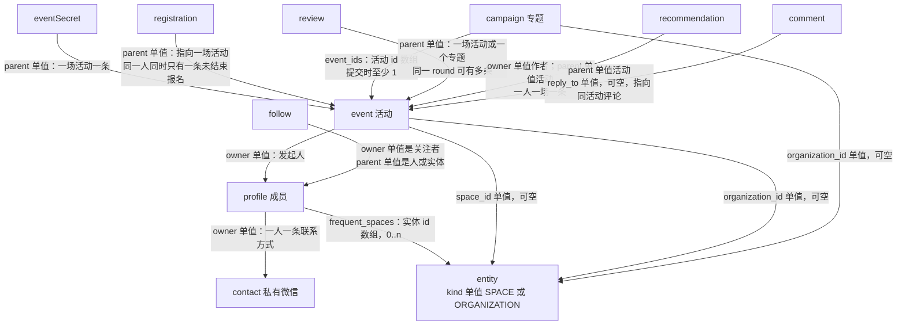

# 706mini 设计数据模型与 schema

2026-10-19。本文整理当前小程序设计实际使用的数据结构。它是设计契约的记录，不是业务验收，也不启动改表、接线或测试。

阅读顺序：模型与关系 → 关键字段 → 完整字段 → 页面派生读模型 → 已有存储覆盖 → 待讨论缺口。

## 边界

设计对象来自当前小程序：

- 表单与校验：`miniprogram/lib/forms.js`、`miniprogram/lib/content-validation.js`
- 读写契约与派生字段：`miniprogram/lib/mock/index.js`
- 合成样例：`miniprogram/lib/mock/seed.js`（虚构数据，不能导入运营库）
- 卡片与信息密度：`docs/design-system-paper.md`

这些对象在小程序 mock 里是同一个 `rows` 数组中的逻辑记录，用 `type` 区分。Montana 侧同样的 24 种业务 JSON 类型共享一张 `community706` 表的 `data` 列，不能画成 24 张 SQL 表。业务关系是记录里的 id 文本或 id 数组。源码里的结构定义不表示当前线上库已经按此建成。

`soon/db/schema.rb` 是主分支候选后端在本工作区的源码 schema。本地 development 库名是 `soon_706mini_development`，由该 schema 准备出空表。生产库没有在本轮读取。下文把 soon 的 SQL 外键和纯文本引用分开写。小程序默认仍是 mock，`miniprogram/lib/api.js` 只在 mock 与 Montana 之间切换，还没有 soon 适配器。

147 项前端需求、81 个 Montana 入口和原 Gap 索引仍在 `frontend-inventory.md` 与 `data-integration-review/`。本文不改那些计数。这些对象落到 soon 已有接口上的设计在 [soon-call.md](soon-call.md)。按页面调用整理的平行接口清单留在 [rest-api.md](rest-api.md)，只作对照。

## 模型与关系

设计域有四组对象。

身份与场所：`profile` 成员公开资料，`contact` 私有微信号，`entity` 空间或组织，`role` 管理权限，`invitation` 管理员邀请。

相聚：`event` 活动，`eventSecret` 报名成功后才可见的参与方式，`registration` 报名，`campaign` 专题，`review` 内容审核，`media` 媒体引用。

关系与动态：`follow` 关注，`mute` 屏蔽，`recommendation` 推荐帖，`comment` 评论，`notification` 站内消息，`report` 举报。

`registrationRollup` 只在动态读模型里出现，没有自己的存储记录。

每条 mock 记录共享外层：`id`、`type`、`owner`、`parent`、`status`、`version`、`created_at`、`updated_at`。`owner` 和 `parent` 的指向随 `type` 变化，见下表。

| 起点 | 字段 | 终点 | 数量 | 含义 |
| --- | --- | --- | --- | --- |
| profile | owner | 账户 id | 单值 | 一个账户一份公开资料。mock 取该 owner 的第一条 profile |
| profile | frequent_spaces | entity.id | 数组，0..n | 常去空间。写入字段是这个数组 |
| contact | owner | 账户 id | 单值 | 微信号。公开资料接口不回传明文 |
| entity | kind | 枚举 | 单值 | `SPACE` 或 `ORGANIZATION`。两种场所共用 `type=entity` |
| role | owner | 账户 id | 单值 | 被授权的人 |
| role | parent | entity.id | 单值，平台角色为空 | 管哪个空间或组织 |
| invitation | parent | entity.id | 单值 | 邀请去管理哪个实体 |
| invitation | owner | 账户 id | 单值 | 被邀请人 |
| invitation | inviter | 账户 id | 单值 | 邀请人 |
| event | owner | profile.owner | 单值 | 发起人 |
| event | space_id | entity.id，且 kind=SPACE | 单值，可空 | 有值时地点名称取空间名，不再要求手填场地 |
| event | organization_id | entity.id，且 kind=ORGANIZATION | 单值，可空 | 可空表示个人发起 |
| eventSecret | parent | event.id | 单值 | 群码、发起人微信或“将联系你”。公开预览不带此记录 |
| registration | parent | event.id | 单值 | 报名指向一场活动 |
| registration | owner | 账户 id | 单值 | 同一人和同一活动同时只保留一条未结束报名 |
| campaign | event_ids | event.id | 数组，提交时 ≥1 | 专题收录哪些活动。应用文本数组，没有连接表 |
| campaign | organization_id | entity.id | 单值，可空 | 专题所属组织 |
| review | parent | event.id 或 campaign.id | 单值 | 审核主体。同一 `round` 有多条任务 |
| review | entity_id | entity.id | 单值，可空 | scope 为 ORGANIZATION 或 SPACE 时指向审核方实体 |
| review | event_id | event.id | 单值，可空 | scope 为 INITIATOR 时指向被关联的那一场活动 |
| follow | owner / parent | 账户 id 或 entity.id | 各单值 | 一条关注关系。不能关注自己 |
| mute | owner / parent | 账户 id | 各单值 | 屏蔽某人的动态 |
| recommendation | owner / parent | 账户 id / event.id | 各单值 | 一人对一场活动一条推荐 |
| comment | parent | event.id | 单值 | 评论挂在活动下 |
| comment | reply_to | comment.id | 单值，可空 | 必须和父评论属于同一活动 |
| notification | owner | 账户 id | 单值 | 收件人 |
| notification | target | `{route, id?}` | 单个对象 | 点击后去的页面。`id` 不是固定外键 |
| notification | actor_id | 账户 id | 单值，可空 | 触发者。样例里可缺 |
| report | parent | 被举报记录 id | 单值，可空 | 反馈可以没有具体对象 |
| media | url | 文件地址 | 单值 | 活动 `media[]` 与专题 `media[]` 引用它。私有群码图带 `private: true` |

`featured_entities` 出现在既有 Montana 读取说明里：成员页若已有该数组，读取优先于 `frequent_spaces`。当前设计表单和 mock 的 profile 写入允许列表都不接受它。它不是本轮设计写入字段。

## 关键字段

页面和表单真正依赖的字段。必填指设计校验，不是数据库 NOT NULL。

### profile

公开：`display_name`、`city`、`avatar_url`、`bio`、`introduction`、`interests`（提交时 2–5 个）、`public_links`、`frequent_spaces`、`visibility`、`share_activity`。

本人设置：`locale`、`notification_preferences`、`onboarded`。完成引导时要求隐私同意；mock 把同意记成 `onboarded`，不把同意文案存进公开字段。

`wechat` 不进 profile，进 `contact`。

### entity

`kind`、`name`、`city`、`cover_url`、`address`、`opening_hours`、`introduction`、`public_contact`、`allow_event_requests`。

空间主页还可以带 `public_links`：主理人、演示公众号、回顾文章。这和成员资料里的作品链接不是同一种元素。

### event

身份与归属：`title`、`summary`、`description`、`owner`、`organization_id`、`space_id`。

时间地点：`starts_at`、`ends_at`、`city`。无 `space_id` 时 `venue_name` 与 `address` 必填。

参与：`capacity`（空表示不限）、`price_minor`（整数，单位分；0 为免费）、`approval_required`、`waitlist_enabled`、`visibility`。

内容：`media[]`、`cover_url`（第一张图片派生）、`tags`、`fit_description`。

状态：`status`、`round`、`version`。

### eventSecret.access

`methods` 为 1–3 个元素，`type` 不重复。每个元素是 `{type, value, expires_at?}`。

`type` 只允许 `GROUP_QR`、`ORGANIZER_WECHAT`、`ORGANIZER_WILL_CONTACT`。

### registration

`parent`、`owner`、`display_name`、`motivation`、`status`、`approval_status`、`contact_share_consent`、`consent_version`、`payment_expires_at`。

### campaign

`title`、`kicker`、`introduction`、`media[]`、`organization_id`、`event_ids`、`resource_links`、`status`、`round`、`version`。

### review

`parent`、`subject_type`（`event` 或 `campaign`）、`scope`、`round`、`status`、`entity_id`、`event_id`、`note`、`snapshot`、`decided_by`。

### 关系记录

`follow` 与 `mute` 用 `owner`、`parent`、`status`。`recommendation` 再加 `text`。`comment` 再加 `text`、`reply_to`。`notification` 用 `category`、`key`、`target`、`status`。

## 完整字段

类型写的是设计值。日期是 ISO 字符串。id 都是字符串。未写“提交必填”的字段可以在草稿里空着。

### 记录外层

| 字段 | 类型 | 约束 | 说明 |
| --- | --- | --- | --- |
| id | string | 有记录则必有 | mock 本地新建使用 `demo-local-*` |
| type | string | 必有 | 逻辑类型，不是表名 |
| owner | string | 通常是账户 id | 审核、邀请等类型另有自己的接收人语义，以上表为准 |
| parent | string | 可空 | 含义随类型变化 |
| status | string | 随类型 | 见状态表 |
| version | number | 从 1 递增 | 保存、提交、审核决定带版本；不一致则冲突 |
| created_at / updated_at | ISO string | 写入时生成 | 展示用，不作为业务主键 |

### profile

| 字段 | 类型 | 约束 | 说明 |
| --- | --- | --- | --- |
| display_name | string | 保存时非空 | 公开称呼 |
| avatar_url | string | 可空 | 头像地址 |
| city | string | 完成资料时必填 | 城市 id，来自 `read.config` 的 `cities[]` |
| bio | string | 可空 | 短介绍。成员页在本人改过 bio 之前可以显示来源短句 |
| introduction | string | 可空 | 长介绍 |
| interests | string[] | 提交时 2–5 | 当前选项同时存在中文 value 与英文 key，选中判断两边都认。枚举尚未收成单一词表 |
| public_links | `{kind, label, url}[]` | 可空 | 表单把作品链和社交链合成此数组。`kind` 为 `work` 或 `social` |
| frequent_spaces | string[] | 可空 | 实体 id |
| visibility | string | 可空 | 样例为 `PUBLIC` 或 `MEMBERS`。非 `PUBLIC` 或非 `ACTIVE` 的资料不进入公开 DTO |
| share_activity | boolean | 可空 | 为真时，报名才出现在他人可见的参与和动态里 |
| locale | string | 可空 | 语言偏好 |
| notification_preferences | object | 可空 | 样例只有 `{enabled}`。具体开关表未冻结 |
| onboarded | boolean | 引导完成时为真 | 新人样例为假 |

公开读 DTO 只带：`id`、`owner`、`display_name`、`avatar_url`、`bio`、`introduction`、`city`、`interests`、`public_links`、`frequent_spaces`。

### contact

| 字段 | 类型 | 约束 | 说明 |
| --- | --- | --- | --- |
| wechat | string | 可空 | 仅本人 `selfContact`，或报名管理在对方同意后读取 |

Montana 目录把该值放在加密 blob 里。mock 为了演示直接放了虚构字符串。两种存放都不进入公开 profile。

### entity

| 字段 | 类型 | 约束 | 说明 |
| --- | --- | --- | --- |
| kind | string | 单值 | `SPACE` 或 `ORGANIZATION` |
| name | string | 表单必填 | 空间或组织名 |
| city | string | 表单必填 | 城市 id |
| cover_url | string | 可空 | 封面 |
| address | string | 表单必填 | 公开地址 |
| opening_hours | string | 表单必填 | 开放时间文本，不是结构化时段 |
| introduction | string | 表单必填 | 介绍 |
| public_contact | string | 表单必填 | 公开联系入口。非管理人的实体 DTO 会删掉它 |
| allow_event_requests | boolean | 表单有此开关 | 样例读写没有用它过滤活动。行为仍待确认 |
| avatar_url | string | 可空 | mock 更新接受，设计表单没有这一项 |
| public_links | object[] | 可空 | 空间链：`host`（`user_id`、`role`）、`official_account`、`recap`（`label`、`published_at`、`cover_url`、`excerpt`） |

### role

| 字段 | 类型 | 约束 | 说明 |
| --- | --- | --- | --- |
| scope | string | 必有 | `PLATFORM`、`ENTITY`。审核任务另用 `ORGANIZATION`、`SPACE`、`INITIATOR`，那是 review.scope，不是 role.scope |
| role | string | 必有 | 样例为 `OWNER` 或 `ADMIN` |
| status | string | 必有 | `ACTIVE` 或 `REVOKED` |

平台角色的 `parent` 为空。实体角色的 `parent` 是实体 id。撤销会把同一人、同一实体上的 role 标为 `REVOKED`，并撤回尚未接受的邀请。`OWNER` 与平台角色不能被撤销接口撤掉。

### invitation

| 字段 | 类型 | 约束 | 说明 |
| --- | --- | --- | --- |
| role | string | 样例固定 `ADMIN` | 邀请成为实体管理员 |
| status | string | 必有 | `PENDING`、`ACCEPTED`、`REVOKED` |
| inviter | string | 必有 | 接受时邀请人仍须是该实体 OWNER 或平台角色 |

### event

| 字段 | 类型 | 约束 | 说明 |
| --- | --- | --- | --- |
| title | string | 提交必填 | 名称 |
| summary | string | 可空 | 卡片与列表用的短句 |
| description | string | 提交必填 | 正文 |
| fit_description | string | 可空 | 适合人群。样例有，表单定义没有单独一项 |
| media | `{type, url, label?}[]` | 可空 | `image` 最多 9，`video` 最多 1，`link` 最多 3。链接必须是 http(s) |
| cover_url | string | 派生 | 取 `media` 里第一张 `image` 的 url |
| starts_at / ends_at | ISO string | 提交必填 | 开始时间须晚于提交当时；结束须晚于开始 |
| city | string | 提交必填 | 须在配置城市表内 |
| space_id | string | 可空 | 有值则地点显示空间名 |
| venue_name / address | string | 无空间时提交必填 | 临时场地 |
| organization_id | string | 可空 | 有值时，发起人须能管理该组织，或是平台角色 |
| capacity | integer 或 null | 空或 ≥1 | null 表示不限。未知容量时卡片只显示人数，不编造分母 |
| price_minor | integer | ≥0 | 分。表单用元，保存时乘 100。大于 0 即付费 |
| approval_required | boolean | 默认假 | 为真时新报名先进入 `REQUESTED` |
| waitlist_enabled | boolean | 默认真 | 为假且已满则拒绝报名 |
| tags | string[] | 可空 | 表单是逗号分隔文本，保存时拆开 |
| visibility | string | 写入固定 `PUBLIC` | 读取把 `MEMBERS`、`UNLISTED` 视为非公开 |
| status | string | 见状态表 |  |
| round | integer | 从 0 起 | 每次提交审核加 1 |
| host_display / venue_display | string | 展示缓存 | 提交时分别由发起人昵称、空间名或场地名重写。权威来源是 owner、space_id、venue_name |

当前配置城市：`shanghai`、`beijing`、`guangzhou`、`shenzhen`、`hangzhou`、`chengdu`，时区样例为 `Asia/Shanghai`。权威列表是 `read.config.cities`，不是一张城市表。

### eventSecret

| 字段 | 类型 | 约束 | 说明 |
| --- | --- | --- | --- |
| access.type | string | 与 methods 一起校验 | 兼容旧的单值形状 |
| access.value | string | 可空字符串 | 群码媒体 id、微信号文本，或说明文案 |
| access.methods | 数组，1–3 | type 唯一 | 过期元素在读取时滤掉；滤完为空则访问失败 |
| access.expires_at | ISO string | 可空 | 整体过期或单个 method 过期 |

只有报名状态为 `CONFIRMED` 的本人，或活动管理人，可以读取。草稿预览可以带上它；公开活动详情不带。

### registration

| 字段 | 类型 | 约束 | 说明 |
| --- | --- | --- | --- |
| display_name | string | 报名必填 | 本次报名使用的称呼 |
| motivation | string | 可空 | 申请说明 |
| status | string | 见状态表 |  |
| approval_status | string | `PENDING` 或 `APPROVED` | 与 `status` 分开。候补被递补时，未批准的仍回到 `REQUESTED` |
| contact_share_consent | boolean | 默认假 | 为真且状态属于申请中、待支付、已确认时，管理人可以读微信号 |
| consent_version | string | 报名时写入 | mock 写入 `706-2026-10-08` |
| payment_expires_at | ISO string | 待支付时有值 | mock 给予 30 分钟。过期后状态变为 `EXPIRED`，并尝试递补候补 |
| privacy_consent | boolean | 请求参数 | 不落成公开字段。未同意不能报名 |

付费且已确认的报名，取消接口直接拒绝，并要求退款规则。mock 不创建退款记录。`REFUNDED` 只出现在“已结束报名”的过滤名单里，没有写入路径。

### campaign

| 字段 | 类型 | 约束 | 说明 |
| --- | --- | --- | --- |
| title | string | 提交必填 |  |
| kicker | string | 可空 | 眉题 |
| introduction | string | 提交必填 |  |
| media | `{type, url}[]` | 可空 | 专题只限制 `image` 最多 12 |
| cover_url | string | 派生 | 同活动，取第一张图 |
| organization_id | string | 可空 | 有值时提交人须能管理该组织 |
| event_ids | string[] | 提交至少 1 | 每场活动状态须是 `PUBLISHED` 或 `IN_REVIEW` |
| resource_links | string[] | 可空 | 表单是按行拆开的 URL 文本 |
| visibility | string | 写入 `PUBLIC` |  |
| status / round |  | 同活动 | 专题保存允许的状态含 `PUBLISHED`；活动保存允许 `DRAFT`、`CHANGES_REQUESTED`、`IN_REVIEW` |

发起人审核拒绝时，从 `event_ids` 去掉对应活动，不把整个专题打回。其他 scope 拒绝则主体变为 `CHANGES_REQUESTED`。

### review

| 字段 | 类型 | 约束 | 说明 |
| --- | --- | --- | --- |
| subject_type | string | `event` 或 `campaign` |  |
| scope | string | 必有 | `PLATFORM`、`ORGANIZATION`、`SPACE`、`INITIATOR` |
| entity_id | string | 组织/空间审核时有 | 审核人须管理该实体；平台审核人须有平台角色 |
| event_id | string | 发起人审核时有 | 审核人须是该活动的 owner |
| round | integer | 与主体 round 一致 | 主体再次保存并处于审核中时，本轮未决任务变为 `SUPERSEDED` |
| status | string | 见状态表 | 决定时任务必须仍是 `PENDING`，主体必须是 `IN_REVIEW` |
| note | string | 拒绝时必填 |  |
| snapshot | object | 提交时拷贝主体 | 审核当时的主体内容 |
| decided_by | string | 决定后有 | 决定人账户 id |
| title | string | 冗余 | 列表展示。读任务时也会再取主体标题 |

活动提交生成的审核方：平台一条；有组织再加一条；有空间再加一条。专题再为每个 `event_ids` 加一条发起人确认。全部必审任务通过，且发起人拒绝只表现为去掉活动之后，主体变为 `PUBLISHED`。专题若因此没有任何活动，变为 `CHANGES_REQUESTED`。

### follow、mute、recommendation、comment、notification、report、media

| 类型 | 字段 | 说明 |
| --- | --- | --- |
| follow | status `ACTIVE` / `INACTIVE` | 再次关注只改状态，不新增第二条 |
| mute | parent 为被屏蔽的人 | 当前写入只创建屏蔽，没有取消接口 |
| recommendation | text、status | `enabled: false` 把状态改为 `INACTIVE`，保留原文 |
| comment | text、reply_to、status | 删除把 status 设为 `DELETED` 并清空 text。本人或平台角色可删 |
| notification | category、key、target、status、actor_id | category 样例为 `EVENT`、`SOCIAL`、`ADMIN`。status 为 `UNREAD` 或 `READ` |
| report | reason、status `OPEN` | reason 必填 |
| media | url、private | 上传返回 `{id, url, preview_url}` |

已观察到的通知 `key`：`CONFIRMED`、`COMMENTED`、`ROLE_INVITED`、`REGISTRATION_REQUESTED`、`REVIEW_APPROVED`、`EVENT_CANCELLED`，以及报名状态字符串本身。这是写入点的集合，不是封闭枚举。

`calendarShare` 只有 `params`，供分享场景还原日历筛选。它是分享指针，不是活动的一种。

## 状态

### event.status 与 campaign.status

| 值 | 含义 |
| --- | --- |
| DRAFT | 草稿。可保存 |
| IN_REVIEW | 已提交，等待本轮审核。活动此状态下仍可保存，保存会使本轮任务作废 |
| CHANGES_REQUESTED | 被退回。可再保存并再次提交 |
| PUBLISHED | 公开可见。专题此状态下仍可保存；活动公开后的修改口在设计里是取消或另存草稿 |
| CANCELLED | 活动取消。付费且已有确认报名时，取消被退款规则挡住 |

公开目录只收录 `PUBLISHED`，并且 `visibility` 不是 `MEMBERS` 或 `UNLISTED`。

### registration.status

未结束：`REQUESTED`、`WAITLISTED`、`APPROVED_AWAITING_PAYMENT`、`CONFIRMED`，以及写入过程中的瞬时 `PENDING`。

已结束：`REJECTED`、`CANCELLED`、`EXPIRED`、`REFUNDED`。

名额只计算 `CONFIRMED`，加上尚未过期的 `APPROVED_AWAITING_PAYMENT`。`capacity == null` 时没有剩余名额概念。

报名截止在设计里是开始前 120 分钟。支付本身在 mock 里是演示确认，`read.config.capabilities.payment` 为 false。

### review.status

`PENDING`、`APPROVED`、`CHANGES_REQUESTED`、`SUPERSEDED`。

## 页面派生读模型

这些字段由读取时计算。它们不是存储列，也不能要求后端原样落一张表。

### 活动卡片

共享卡片展示：标题、海报、一个只读状态/人数标签、自然日期、发起者与组织合成的一行、地点一行、费用。

读取时附加：

| 字段 | 计算 |
| --- | --- |
| initiator | 发起人公开资料 |
| registered | `CONFIRMED` 人数 |
| remaining | 容量为空则为 null，否则为容量减去占用数 |
| participants | 最多 5 个公开且允许分享参与的确认报名者。卡片规范不展示这条头像带 |
| registration | 当前用户未结束的那条报名，否则最近一条 |
| recommended | 当前用户是否仍有有效推荐 |
| can_manage / can_edit | 发起人、平台角色，或能管理其组织 |
| pending_count | 仅管理人可见的 `REQUESTED` 数 |
| campaigns | 详情页：收录了这场活动且自身公开的专题 |

人数标签示例是“报名中 12/20”。容量未知时只显示参与人数。“我的报名”列表可以在卡片外显示个人进度。卡片不放个人报名状态、推荐星或发起人头像。

### 动态

两种元素：

- 推荐：推荐记录加上 `author` 公开资料和嵌套的活动卡片。被当前用户屏蔽的作者不出现。
- 聚合报名：没有存储行。`id` 形如 `attendance-{eventId}`，`type` 为 `registrationRollup`，带 `actors`、`count`、嵌套活动。它比推荐更安静，界面不解释合并机制。

### 成员、空间、人推荐

成员页附加：`following`、`following_count`、`followers_count`、`activity_count`、`frequent_entities`、`items`。`share_activity` 为假时不公开其参加的活动。

人推荐附加 `reason`：`FOLLOWS_YOU`、`COMMON_EVENT`、`COMMON_SPACE`、`COMMON_RECOMMENDATION`，否则 `SAME_CITY`。列表排除本人。

空间目录可以附加 `event_count` 与 `active_member_count`。关注流的节点橱窗最多 4 个已关注空间，同城在前；没有关注时最多 2 个同城探索，并标明来源。节点卡带 `space` 路由和空间 id。

### 审核与消息

审核列表按 `parent` 去重，标题取主体。进度读模型是主体加上它的全部 review。消息按 `category` 过滤，可单条或全部标已读。

## 已有存储怎么覆盖这些对象

### Montana：一种物理表

历史源码里的业务记录放在 `<app.pg_schema>."community706"`。列是 `id`、`type`、`owner`、`parent`、`status`、`data`、`version`、`created_at`、`updated_at`。上面的逻辑类型放在 `type` 与 `data` 里。`$users`、`$files` 另有表。10 张 runtime 表是另一套支撑结构。

`owner`、`parent`、`data` 里的 id 和 id 数组是应用文本引用。源码没有把它们声明成 SQL 外键。当前生产库的 schema、索引和历史 JSON 本轮没有重读。字段级证据仍在 `storage-catalog.md`。

### soon：本工作区源码 schema

主键是字符串 TSID。下表只列出和设计对象有关的表。标成 SQL 外键的，来自 `soon/db/schema.rb` 的 `add_foreign_key`。没有列出的引用只是字符串列。

| 设计对象 | soon 表 | 已声明的 SQL 外键 | 对应情况 |
| --- | --- | --- | --- |
| profile | `users` | 无出站外键 | 有 `nickname`、`bio`、`image_url`、`social_links`、`data` jsonb。没有 `city`、`interests`、`frequent_spaces`、`share_activity` 列 |
| contact.wechat | 无对应列 |  | `users.wechat_openid` / `wechat_unionid` 是登录身份，有唯一索引。它们不是用户填写的微信号 |
| entity ORGANIZATION | `groups` | `groups.parent_id` 有索引，schema 未声明自外键 | 社区/群组。没有 `kind`，也没有设计里的开放时间与城市 id |
| entity SPACE | `groups` 与 `venues` 都像，但都不是 | `venues.group_id`、`venues.owner_id`、`venues.place_id` 是 SQL 外键；`group_id` 必填 | 设计中的空间是可关注、可管理的节点。`venues` 是某个 group 下的场地 |
| event | `events` | `group_id`、`owner_id`、`venue_id`、`place_id`、`form_id`、`track_id` 是 SQL 外键；`group_id` 与 `owner_id` 必填 | 有标题、正文、起止时间、容量、`require_approval`、状态。没有 `price_minor`、`city`、候补开关、参与方式 |
| event 费用与名额 | `tickets`、`payment_methods`、`ticket_items` | `tickets.event_id`、`tickets.group_id` 是 SQL 外键 | 价格在 `payment_methods.price`，数量在 `tickets.quantity`。一张活动可以有多张票 |
| registration | `participants` | `event_id`、`user_id` 是 SQL 外键；`(user_id, event_id)` 唯一 | 状态注释是 attending、pending、declined、maybe、cancelled。没有候补、待支付过期、联系同意 |
| campaign | 无表 |  | `event_ids` 没有落点 |
| review | 无内容审核任务表 |  | hackathon 项目上的审稿字段属于另一个模块 |
| role | `memberships` | `group_id`、`user_id` 是 SQL 外键；`(user_id, group_id)` 唯一 | 列注释写 member、admin、owner。设计用 OWNER、ADMIN，并另有平台 scope |
| invitation | `group_invites` | `group_id`、`receiver_id`、`sender_id` 是 SQL 外键 | 列注释的角色是 member、manager、owner；状态是 sending、requesting、accepted、cancelled、revoked |
| comment | `comments` | `user_id`、`reply_parent_id` 是 SQL 外键 | `item_type` + `item_id` 是多态文本，schema 未给 event 外键。`comment_type` 含 comment、star、chat、checkin、feedback |
| recommendation | 无同形表 |  | star 评论不是一条带正文、可撤回、会进入关注流动态的推荐 |
| notification | `activities` | `initiator_id`、`receiver_id` 是 SQL 外键 | 有 `action`、`has_read`、`payload`。`item_type` + `item_id` 无 SQL 外键。没有设计里的 category / target.route |
| follow / mute | 无社交表 |  | `fed_follows` 是联邦投递关系 |
| eventSecret | 无对应私有记录 |  | `events.meeting_url` 是活动上的普通字符串 |
| media | URL 列 |  | 模型存 Cloudflare 返回的 URL，没有设计里的 `{type, url}` 数组和私有群码记录 |
| report | 无同形表 |  | 若干模型有 flag 字段，语义是内容标记，不是用户反馈单 |

`events.status` 的列注释是 `draft | pending | published | archived | closed | cancelled`。设计状态是 `DRAFT | IN_REVIEW | CHANGES_REQUESTED | PUBLISHED | CANCELLED`。两边词表不同，不能直接对等。

`memberships.role` 的列注释是 member、admin、owner。`Group#admin_notification_emails` 查询的是 owner 和 manager。这是 soon 源码内部的用词差异，映射设计里的 ADMIN 之前要先定 soon 自己的角色词。

## 待讨论缺口

下面只登记差异。确认归属之前，不据此改 schema，不把小程序接到 `/api/v1`，也不把 mock 数据导入 `soon_706mini_development`。

1. 专题、多轮内容审核、关注、屏蔽、推荐帖、私有参与方式，在 soon schema 里没有同形的表或列。
2. 空间和组织在设计里是一种记录加一个 `kind`。soon 把群组、场地、地址拆成 `groups`、`venues`、`places`，且场地必须属于一个 group。
3. 设计允许没有组织的个人活动。soon 的 `events.group_id` 是必填 SQL 外键。
4. 设计的费用是活动上的一个整数分。soon 的价格和库存在票与支付方式上，一个活动可以有多张票。
5. 设计报名含申请、候补、待支付、确认、拒绝、过期。soon 参与者状态没有这组值，支付过期也不在 `participants` 行上。
6. 付费报名的取消、付费活动的取消，设计要求退款规则后才允许。规则本身未定。soon 另有 `refunds` 与售后表，尚未按这个设计对过。
7. 城市、兴趣、常去空间、是否公开自己的参与，在 `users` 上没有对应列。`users.data` jsonb 可以临时承载，但那仍然是未约定的袋子，不是已确认的 schema。
8. 微信号与微信 openid 是两种数据。前者是联系方式，后者是登录身份。
9. 站内消息的分类和跳转目标，与 `activities.action` 还没有字段级对照。
10. 管理员、主理人、member、manager、owner、ADMIN 几套词还没有一张对照表。
11. 兴趣词表同时存在中文和英文 key。城市表目前来自配置接口的六个样例城市。
12. `allow_event_requests`、`featured_entities`、成员页 bio 的来源短句，有字段或读取分支，但当前设计写入没有把它们定义完整。

接口覆盖的现状可以收成三句。小程序设计契约由 mock 读写实现，默认模式就是 mock。Montana 函数覆盖记录在原对接网页里，生产可用性未在本轮重测。soon 的 `/api/v1` 随本仓库源码存在，小程序还没有调用它。

## 证据

| 设计事实 | 位置 |
| --- | --- |
| 四类表单字段与提交必填 | `miniprogram/lib/forms.js` 的 `definitions`、`validate`、`payload` |
| 媒体数量与参与方式枚举 | `miniprogram/lib/content-validation.js` |
| 关系、状态迁移、派生卡片 | `miniprogram/lib/mock/index.js` |
| 样例记录与城市 | `miniprogram/lib/mock/seed.js` |
| 卡片展示取舍 | `docs/design-system-paper.md` 第 4、5 节 |
| Montana 物理表与 24 种逻辑类型 | `docs/data-integration/storage-catalog.md` |
| soon 列、索引、SQL 外键 | `soon/db/schema.rb` |
| 本地库名 | `soon/config/database.yml` 的 development.database |
