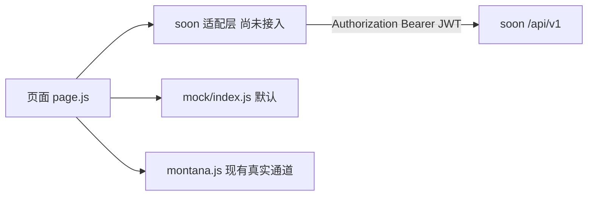
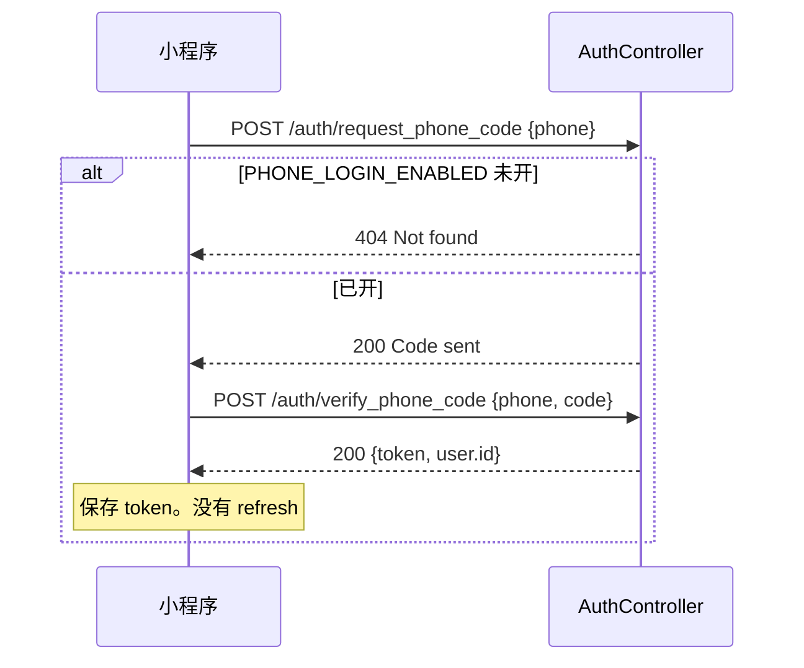
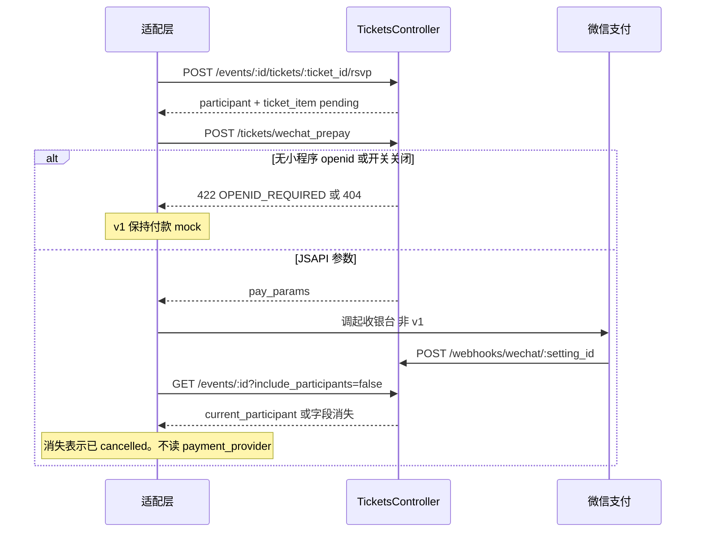

# 706mini 如何调用 soon

| 项 | 值 |
| --- | --- |
| 作者 | 待填写 |
| 日期 | 2026-10-19 |
| 状态 | Draft |
| 读者 | 熟悉 706mini 与 `soon/` 的后端和客户端工程师 |
| 性质 | 设计契约。不是业务验收，不批准改表、接线、测试或部署 |

本文只回答一件事：微信小程序的屏幕动作，怎样落到 `soon` 已经存在的 `/api/v1` 上。能用现有方法、路径、JSON 键就用。派生展示留在将来的小程序适配层。`soon` 表达不了的行为，按「已有列 → 已有 jsonb → 已有枚举加值 → 已有资源加动作 → 新表」往下退，并且写明上一级为什么不够。

实现本文任何一节都没有被本文授权。小程序默认仍是 mock，真实通道仍是 Montana。本文不改 `miniprogram/lib/api.js`。

## 2026-10-20 已定

下面这些决定覆盖后文里与之冲突的句子。后文若仍写「关注非 v1」「城市在 `places.data`」「专题是 group 壳」「公开名单含未取消的全部状态」「退款只有现有 `refund?`」，以本节为准。

1. 专题是新表 `campaigns`。收录用 `event_ids` 字符串数组，没有连接表，也没有 `events.campaign_id`。同一活动 id 可以出现在多个专题的数组里。一个专题数组内部去重。活动的 `group_id` 仍然不能改。
2. `events.city` 与 `groups.city` 是新的字符串列，存城市 id（`shanghai` 这一类）。城市日历和空间目录在分页前按这两列精确过滤。不再把城市放进 `places.data` 或 `groups.data` 来当筛选键。成员资料上的城市仍在 `users.data.city`。
3. 已支付报名在退款完成前禁止取消。`payment_status` 为 `succeeded` 时，`DELETE` 参与者返回 422。退款调用者是这场活动的发起人（`events.owner_id`），或该活动所在群的 `manager` / `owner`。现有 `co_host` 仍可退。群 `manager` 今天不能退，这次要加上。
4. 小程序有自己的 appid。新增 `POST /api/v1/auth/wechat_miniprogram`，请求体只有 `js_code`。服务器用小程序 app secret 换 openid。不接受客户端传来的 openid，也不使用 `NEXT_TOKEN`。
5. 增加 `follows`。关注者是 `user_id`。对象是 `target_type`（`User` 或 `Group`）加 `target_id`。同一对只有一行，再次关注把 `status` 改回 `active`，取关改为 `inactive`。
6. 增加 `blocks` 与 `reports`。屏蔽可以取消：`DELETE /api/v1/blocks/:id` 只允许屏蔽者本人。举报创建在小程序里；处理接口只给 `users.admin`，小程序不调用。
7. 公开参与者名单只含确认参加的人：`status = attending`，且 `payment_status` 为 null 或 `succeeded`。待审、已拒绝、maybe、以及已占座但未支付的人不在公开名单和活动详情的嵌套数组里。管理者要待审名单时显式传 `status=pending`。
8. 旧活动和旧群的 `city` 不回填。空值继续留在城市日历和空间目录外面。
9. 专题审核用新表 `reviews`，只挂在 `campaigns` 上。审核人是专题创建人（`campaigns.owner_id`），不是 `users.admin`，也不是每场活动的发起人。活动仍走现有的群内单级 `pending` / `approve`。候补、成员城市独立列、报名隐私同意落库、私有群码，本轮不做。开放平台和商户号是否已经绑到这个小程序 appid，本轮不改设计。
10. 读专题收录的活动时，用 `event_ids` 和活动当前状态取交集。公开读只留下 `status = published` 且行还在的活动。数组里的 id 不因为活动后来变成别的状态而删掉。
11. 消息仍用 `activities`。除了现有的入群和改角色，还要写入报名申请、报名通过、评论、推荐、活动取消、专题通过。每条都带 `receiver`。
12. 活动上只要有带 `payment_methods` 的票，`participants#create` 就 422，不能免费报名。同一用户、同一张票已有 `succeeded` 或 `partially_refunded` 的订单时，`#rsvp` 422，不能再下一单。
13. 邀请的四条路径都不允许把人加成 `owner`（调用者本人不是 owner 时），也不允许覆盖已有角色。四条是 `GroupInvitesController#create`、`MembershipsController#create`、`#send_with_code`、`#accept_with_code`。
14. 后端单独部署，数据库不与 sola 共用，也不使用 `sails_production`。行为变更只影响这个部署。
15. soon 不放在 706mini 这个仓库里。代码在 `git@github.com:sociallayer-im/soon.git` 的 `706mini` 分支。706 的改动提交到那条分支，不提交到 soon 的 `main`。本文里的 `soon/` 路径是指那个仓库的根目录。

## Overview

706 的设计对象（成员、空间或组织、活动、报名、评论、消息）在小程序里今天由 `miniprogram/lib/mock/index.js` 用一个 `rows` 数组表达，字段名是 `display_name`、`price_minor`、`space_id` 这一套。Montana 把同样的逻辑类型放进 `community706.data`，那不是目标存储，也不对应 soon 的 24 张表。

`docs/data-integration/rest-api.md` 曾按这套 mock 另起了 `/entities`、`/campaigns`、`/reviews`、`/follows`、`/registrations`。soon 的 `config/routes.rb` 里没有这些资源。那份清单是对照，不是目标协议。

目标协议就是 soon 现有路由。适配层把 soon 的 `nickname`、`venue_id`、`group_id` 拼成屏幕上的一行发起人和人数。卡片上的费用读列表标量 `ticket_price`，不从 `payment_methods.price` 现拼，也不为每张卡片再请求详情。`payment_methods.price` 只用于活动详情和建票 body。不让 soon 为卡片再返回一套 DTO。登录用邮箱、手机验证码，或新的小程序 `js_code` 接口。JWT 原样保存 30 天，不新造刷新接口。收银台仍是单独开关。关注用 `follows`，不用 membership。

本地 development 库名是 `soon_706mini_development`（`soon/config/database.yml`），只是迁移后的空表。`soon/db/schema.rb` 是本工作区源码 schema。本文不声称生产库已经是这个结构。

## Background & Motivation

小程序屏幕需要的对象和状态记在 `docs/data-integration/design-schema.md`。soon 已经有用户、群组、活动、参与者、票、评论和活动流，字段和权限也已经在控制器里定死。再平行做一套资源名，会让同一条报名在 `participants` 和一张新的 registrations 表里各有一套状态。

当前调用链：

- `miniprogram/lib/api.js` 只在 mock 与 Montana 之间切换。`mode()` 读 `706.transport`，不是 `soon` 就不走 soon。
- `miniprogram/lib/montana.js` 用 `POST /runtime/auth/*` 发验证码，业务走 WebSocket 上的 `community:read` / `community:write`。它的 `refresh-token` 是 Montana 会话，不是 soon 的 JWT。
- `miniprogram/lib/page.js` 通过 `read(op)` / `write(op)` 要卡片、关注流、审核进度。这些 op 名是 mock 的，不是 HTTP 路径。

痛点是屏幕字段和 soon 字段不是同一个词表，而且有几处 soon 的行为比设计更窄（没有候补、没有多轮审核、没有站内关注）或更宽（已知用户的管理员邀请会直接写入 membership，不会停在待接受）。适配层必须按 soon 的真实行为说话，不能按 mock 的状态机假装服务器会拒绝。

## Goals & Non-Goals

### Goals

- 给每个 v1 屏幕动作标出 soon 的方法、路径、控制器动作、请求字段和响应字段。字段名用 blueprint 的 JSON 键。
- 区分 SQL 外键和纯字符串引用。
- 把派生展示留在适配层，并写明它读哪些 soon 响应。
- 新表是 `follows`、`blocks`、`reports`、`campaigns`、`reviews`。另加列 `events.city`、`groups.city`、`users.wechat_mini_openid`。
- 写明小程序登录、专题审核、取消屏蔽，以及举报处理接口为什么不进小程序。候补、活动多轮审核和私有群码仍不做。

### Non-Goals

- 不实现适配器，不改 `miniprogram/lib/api.js`，不把默认传输从 mock 改成 soon。
- 不把 soon 改成 Montana 的函数协议，不迁 sails 生产数据。
- 不讨论 hackathon、poll、shop、badge、OAuth 管理端、联邦，除非某个 706 动作正好能复用其中的接口。本文只把 `fed_follows` 排除掉，不设计联邦。
- 不读取或记录 `master.key`、`.env`、微信 token、`NEXT_TOKEN`。
- 本文的清单不启动开发、测试、GUI 或部署。

## Proposed Design

### 适配层放在哪

将来若接线，新增一个与 `montana.js` 并列的 soon 客户端，由显式的传输开关选中。在那之前 `api.js` 保持现状。适配层做四件事：把屏幕表单写成 soon 的请求体，把多个 soon 响应拼成页面，把 soon 的状态词翻译成界面文案，在 soon 会接受但 706 设计不允许的动作上不发请求。它不发明第二套 JSON 给页面缓存。



分页沿用 `Api::BaseController#render_collection`，不要改成 `rest-api.md` 的 cursor。默认 `limit` 20，最大 500（`PAGY_MAX_LIMIT`）。查询参数是 `page` 与 `limit`。

```json
{
  "data": [],
  "meta": {
    "page": 1,
    "limit": 20,
    "total": 0,
    "total_pages": 0,
    "next_page": null,
    "prev_page": null
  }
}
```

单条资源没有这层包装，直接是 blueprint JSON。错误体是 `{ "error": "字符串" }`，不是 `{ "error": { "code" } }`。Pundit 拒绝是 `{ "error": "Forbidden" }`，401 是 `{ "error": "Unauthorized" }`。适配层用 HTTP 状态加错误字符串映射文案。soon 没有 `Idempotency-Key`，也没有记录 `version`。重复报名靠 `(user_id, event_id)` 唯一索引返回 `User can only participate once per event`。乐观锁冲突是 mock 行为，v1 不模拟。

规模：这是一个社区小程序，不是 sola 首页那种量级。`Group.with_detail_associations` 的注释写着首页 21 个 popup city、2407 条 membership，那是 sola 的测量，不是 706 的。706 的后端单独部署，数据库单独建，不使用 `sails_production`，也不读 sola 的行。本地开发库仍是 `soon_706mini_development`。列表因此只含这个库里的 706 数据。`Api::BaseController::PAGY_MAX_LIMIT` 是 500。六个城市、每个城市每月数百场，已经超过一页。在一页结果上再滤城市或 `group_tags`，看到的是这一页里碰巧符合的行，不是该城市或该目录。

因此城市和标签谓词加在现有 `#apply_filters` 与 `#directory` 上，在 `render_collection` 之前生效。参数还没落地时，城市日历和空间目录保持 mock。不许用 `limit=500` 的单页冒充日历，也不许靠把 `meta.total_pages` 走完来代替谓词。没有生产 QPS 数字，本文不编造延迟 SLO。个人列表是例外，见活动一节：`owner_id` 已经在分页之前收窄，那种翻页才有界。

### 登录与会话

soon 没有 `/auth/refresh`，也没有 `DELETE /auth/session`。`JwtService::TTL` 是 30 天，`JwtService.encode` 把 `exp` 写进 HS256 JWT。成功体由 `AuthController#render_token` 返回：

```json
{ "token": "<jwt>", "user": { "id": "<tsid>", "email": null, "name": null } }
```

适配层把 `token` 放进微信存储，请求带 `Authorization: Bearer <token>`。`Api::BaseController#bearer_token` 取 header 最后一段。收到 401 就回到登录页，重新走验证码。不要新造刷新接口。登出只删本地 token。服务端 JWT 在过期前仍然有效，这是缺口，v1 接受，不为此加吊销表。

`merged: true` 只出现在账号合并之后。小程序 v1 不走合并，但若响应里带了它，必须换成新 token。

邮箱，不需要开关：

| 动作 | 方法与路径 | 控制器 | 请求 | 成功 |
| --- | --- | --- | --- | --- |
| 发码 | `POST /api/v1/auth/request_code` | `AuthController#request_code` | `email`，可选 `context=bind_email` | `{ "message": "Code sent" }` |
| 验码 | `POST /api/v1/auth/verify_code` | `#verify_code` | `email`、`code` | 上面的 `token` |

未知邮箱在验码时 `User.find_or_create_by!(email:)`，第一次登录即注册。验证码 30 分钟（`AuthCode::EXPIRY`），新码作废旧码。`context` 不要传 `bind_email`，否则验码上下文对不上。

手机，`PHONE_LOGIN_ENABLED` 不是 `true` 时两个动作都 `render_not_found`（404，看起来像没有路由）：

| 动作 | 方法与路径 | 请求 |
| --- | --- | --- |
| 发码 | `POST /api/v1/auth/request_phone_code` | 大陆手机号。服务端收成 `+86` 再存 `users.phone`。`context` 缺省是登录；`bind_phone` 只用于已登录补绑 |
| 验码 | `POST /api/v1/auth/verify_phone_code` | `phone`、`code` |

限流只在手机发码上：`PHONE_CODE_INTERVAL` 是 30 秒，`PHONE_CODE_HOURLY_LIMIT` 是 10。429 的 `code` 有两个：间隔内是 `SMS_COOLDOWN`，一小时超过 10 条是 `SMS_HOURLY_LIMIT`。号码必须匹配 `CN_MOBILE`（`1[3-9]` 开头的 11 位）。手机账号的 `email` 和 `name` 都可以是 null。`name` 是 6–20 位句柄（`HandleName::FORMAT`），不是显示名。微信账号在手机登录开启时，第一次取 `name` 之前必须先绑手机（`UsersController#naming_blocked_pending_phone?`）。v1 若不用微信登录，这条不会碰到。

邮箱 `request_code` 没有对应限流。`AuthController#generated_code` 的注释写明：限制 `#request_code` 本身 “does not exist yet”。本文不新造邮箱限流。适配层仍然不要对同一地址连点。若产品把邮箱登录暴露到会被滥发的环境，那是另一次设计，不在 v1 里假装已经有闸。

微信不是登录：

- `POST /api/v1/auth/bind_wechat` 要求已经有 JWT，外加与 `ENV["NEXT_TOKEN"]` 常量时间比较通过。请求体是 `wechat_openid` 和可选的 `wechat_unionid`，不是 `wx.login` 的 `code`。注释写明：只有持有 app secret 的前端服务器才能宣称 openid。小程序包里不能放 `NEXT_TOKEN`。
- `POST /api/v1/auth/trusted_signin` 同样要 `NEXT_TOKEN`，用 openid 查找或创建用户并 `render_token`。它是服务号网页授权之后的服务器到服务器登录，不是小程序 code 换会话。
- `users.wechat_openid` / `wechat_unionid` 是登录身份，唯一索引。它们不是用户在资料页填写的微信号。`UserBlueprint` 的 `:self` 只给一个布尔 `wechat`，表示这两个列是否有值，不返回 id 本身。`:profile` 和默认视图都没有这个字段。

`soon/design/WECHAT_INTEGRATION.md` §1.3 写明：服务号、小程序、PC 扫码的 openid 互不相同。源码里没有 `jscode2session`。706 小程序使用自己的 appid，因此新增一个登录动作，而不是复用 `trusted_signin` 或 `bind_wechat`。

`POST /api/v1/auth/wechat_miniprogram`，body 只有 `{ "js_code": "..." }`。`AuthController` 用环境变量里的小程序 appid 与 app secret 请求微信 `jscode2session`。secret 只在服务器。成功后取 `openid` 与可选的 `unionid`。`session_key` 不入库、不写日志、不返回。客户端若直接提交 `wechat_openid`，忽略该字段。这个动作不检查 `NEXT_TOKEN`。

身份落到新列 `users.wechat_mini_openid`（唯一，可空）。禁止把小程序 openid 写入 `users.wechat_openid`：那一列是服务号 openid，`#wechat_prepay` 今天用它跟商户 appid 下单，盖掉之后 sola 的服务号支付会对不上。查找顺序：有 `unionid` 时先 `find_by(wechat_unionid:)`，否则 `find_by(wechat_mini_openid:)`。找到则登录；该行的 `wechat_mini_openid` 为空且没有被别人占用时补上。都找不到则 `User.create!`，只写 `wechat_mini_openid` 和 `unionid`，`wechat_openid` 留空。然后走现有 `render_token`。`jscode2session` 不返回昵称和头像，新用户这两项为空。

有 unionid 且开放平台已把这个小程序和服务号绑在一起时，同一个人进同一行。没有 unionid 时，小程序 openid 对不上服务号 openid，会新建用户。这是微信的规则，不是这个接口能合并的。

付款仍看单独的能力开关。开关打开之后，`#wechat_prepay` 在商户 appid 等于小程序 appid 时读 `wechat_mini_openid`，否则仍读 `wechat_openid`。缺对应 openid 时保持今天的 422 `OPENID_REQUIRED`。登录接口本身不调用预下单。

没有 `GET /config`。六个城市 id（`shanghai`、`beijing`、`guangzhou`、`shenzhen`、`hangzhou`、`chengdu`）和时区 `Asia/Shanghai` 是客户端常量，权威来源仍是设计 schema 里的 `read.config.cities`，不是 soon 的表。



### 成员资料

`GET /api/v1/users/:id` 与 `PATCH /api/v1/users/:id`，`UsersController#show` / `#update`。`:id` 可以是 `me`、TSID 或 `users.name`。

公开视图是 `UserBlueprint` 默认字段加 `:profile`：`id`、`name`、`nickname`、`image_url`、`created_at`、`bio`、`eth`、`social_links`。本人看自己，或 `id=me`，用 `:self`，额外有 `email`、`phone`、`permissions`、`admin` 和布尔 `wechat`。没有「资料非公开就 404」。`GET /users/:id` 对任意存在的用户都返回公开视图。适配层不要把非公开资料链出去，但服务器挡不住别人直接请求。这是隐私缺口，v1 不新做可见性列。

现有可写列只有 `user_params`：`name`、`nickname`、`bio`、`image_url`。`email` 故意不在里面。`social_links` 是 jsonb，公开视图会返回，但 `user_params` 不允许写。`users.data` 默认 `{}`，没有任何 blueprint 输出它，控制器也不接收它，应用代码不读这列。`User` 模型没有给 `data` 写注释。`ARCHITECTURE.md` §3.1 只是把列名列出来，并没有把它叫做袋子。「未约定的袋子」这句话在 `docs/data-integration/design-schema.md` 的缺口 7。

`UsersController#update` 忽略路径里的 `:id`，永远 `current_user.update`。`GET` 的 `:id` 可以是别人；`PATCH` 不能改别人。适配层不要把别人的 id 放进 PATCH 并期待 403，这条路径会改掉当前用户。

已有列够用的部分：

| 706 表单 | soon JSON 键 | 说明 |
| --- | --- | --- |
| `display_name` | `nickname` | 空则适配层显示 `name`。`name` 是句柄，不是称呼 |
| `bio` | `bio` | 短介绍 |
| `avatar_url` | `image_url` | 先走上传，再把 URL 写回来 |
| 作品与社交链 | 不写入 `social_links` | soon 的形状是 `{"twitter":"@edge"}` 这种哈希。706 是 `{kind,label,url}[]`。塞进同一列会破坏已有读者 |

已有列不够、因此放进 `users.data` 的键（上一级不够的原因写在表里）：

| 键 | 谁能看见 | 为什么不是已有列 |
| --- | --- | --- |
| `city` | 公开 | 没有城市列。`groups.location` 是群组上的人类地名（测试里是 `"Chiang Mai"`），不是成员城市 id |
| `interests` | 公开 | 字符串数组，没有列 |
| `introduction` | 公开 | `bio` 已用于短介绍，不把两段文案叠进同一列 |
| `public_links` | 公开 | 与 `social_links` 形状不同 |
| `frequent_space_ids` | 公开 | 群组 id 字符串数组。没有外键，应用自己保证 id 存在 |
| `share_activity` | 公开布尔 | 没有列。适配层用它决定成员页和动态是否展示此人的参加记录 |
| `visibility` | 公开 | 没有列。soon 不会因此 404 |
| `locale`、`notification_preferences`、`onboarded` | 仅 `:self` | 没有列 |
| `contact.wechat` | 仅 `:self` | 用户填写的微信号。禁止放进 `wechat_openid`。禁止放进 `:profile` |

最小扩展，仍然不是新表，也不是新资源：`UsersController#user_params` 增加这些键的白名单（不要 `permit` 整个 `data` 哈希），`UserBlueprint` 的 `:profile` 逐个声明公开键，`:self` 再加 `contact.wechat` 和偏好键。禁止 `fields :data`。兴趣 2–5 个、称呼非空、引导完成时要有隐私同意，由适配层在发 PATCH 之前用现有 `forms.js` 的 `validate` 挡住。soon 不强制这些规则。

`share_activity == false` 时，适配层在自己拼出来的成员页和动态里不放此人的参加记录。`GET /events/:id/participants` 和活动详情里的 `participants` 仍会列出所有未取消的参与者。v1 不在 soon 里过滤。其他客户端看得到。这是已知缺口。

`GET /api/v1/users/:id/groups?role=owner,manager` 返回 `MembershipBlueprint` 的 `:with_group`。`role` 按逗号拆开，取值必须是库里的 `member`、`manager`、`owner`。传 `admin` 会得到空列表：`memberships.role` 的列注释写着 `member | admin | owner`，但 `Membership` 的校验是 `%w[member manager owner]`，`ApplicationPolicy#group_admin?` 查的也是 `manager` 和 `owner`。以模型为准。注释和 `ARCHITECTURE.md` §3.2、§8.4 是过期的。

### 空间、组织、场地、地址

空间和组织都是 `groups`。不建 `entities`。区分用已经返回在 `GroupBlueprint` `:card` 上的 `group_tags`：

- `space`：可关注的空间节点。v1 在关注表出现之前，「关注」屏幕仍是 mock，见下文。
- `organization`：组织。
- `personal`：某人的个人发起容器。目录适配层丢掉它。

三个值互斥，这只是适配层规则。服务器不拒绝同时带 `space` 和 `organization`，也不拒绝陌生人把群标成 `space`。`GroupsController::PRIVILEGED_TAGS` 只有 `featured`、`top`、`pin`。`GroupPolicy#create?` 是任意已登录用户，然后 `add_member(current_user.id, "owner")`。非平台管理员写 `group_tags` 时，控制器只剥掉那三个策展词，`space` 会留下。目录一旦按 `group_tags` 含 `space` 过滤，这个群就是公开的 706 空间。

v1 不把 `space` 放进 `PRIVILEGED_TAGS`。放进去之后，小程序没有平台管理员 API（`users.admin` 只在库里改），就再也标不出空间。目录因此信任标签。严重度中：任何拿到 JWT 的人都能造一个空间。缓解是运营看 `GroupRegisteredMailJob`，不是服务器拒绝。不要用 `featured`、`top`、`pin` 表示 706 的 kind。`hidden` 也不是特权标签；`discover` 会排除带 `hidden` 的 popup，那与 706 的空间目录无关。

`groups.location` 不拿来存 `shanghai` 这种城市 id，避免和 sola 的地名冲突。城市是新列 `groups.city`（字符串，可空，有索引），不进 `groups.data`。开放时间、公开地址、公开联系方式、`allow_event_requests`、空间主页链接仍放 `groups.data`。`bio` 留给介绍，三张图列留给封面。`allow_event_requests` 不映射到 `can_publish_event`。设计 schema 写明样例读写没有用它过滤活动，而 `can_publish_event` 会改变 `EventPolicy#create?`。行为未定之前只存储，不改权限。目录的 `city` 参数在分页前比较 `groups.city`。旧行这一列为 null，不回填，不会出现在城市目录里。

`group_params` 今天不接收 `data`。`GroupBlueprint` 也不输出 `data`。最小扩展与用户相同：白名单键，不要整包 `data`。

| 键 | 视图 |
| --- | --- |
| `city`、`opening_hours`、`address`、`public_links`、`allow_event_requests` | `:card`，因此 directory 和详情都有 |
| `public_contact` | 仅当当前用户对该 group `manage?`。做法对齐 `EventBlueprint` 的 `image_note`：没有权限时字段不出现 |

显示名用 `nickname`（`Group#display_name` 在昵称为空时退回 `name`）。`name` 是唯一 slug，6–20 位，规则同 `HandleName`。介绍用 `bio`。封面用 `banner_image_url` 或 `featured_image_url`。

接口：

| 屏幕 | 方法与路径 | 动作 |
| --- | --- | --- |
| 我加入的群 | `GET /api/v1/groups` | `#index`，要登录，分页 |
| 公开目录 | `GET /api/v1/groups/directory` | 今天是 `Group.where(active: true).order(:created_at)` 再 pagy，默认 `limit` 20。扩展后才按标签和城市过滤，见下 |
| 详情 | `GET /api/v1/groups/:id` | `#show`，`:detail`。`:id` 可以是 TSID 或 slug |
| 新建 | `POST /api/v1/groups` | `#create`。任何人登录后可建。事务内 `add_member(current_user.id, "owner")`。提交之后 `GroupRegisteredMailJob` 给平台管理员发信，每个新群一封，包括个人容器 |
| 修改 | `PATCH /api/v1/groups/:id` | `#update`，`GroupPolicy#manage?` |

`:detail` 会带上 `memberships`、未归档的 `venues`、`tracks`、`parent`、`children`。列表只用 `:card` 或默认视图，避免把花名册嵌进每一行。

`venues` 是某个 group 下的房间，不是空间节点。`venues.group_id` 与 `venues.owner_id` 非空，且是 SQL 外键；`venues.place_id` 也是外键，可空。只有活动要占一个可预订房间时才 `POST /api/v1/venues`。`VenuesController#create` 要求对 group `manage?`。`#index` 要登录，可用 `group_id` 过滤。`GET /venues/:id` 公开，带 availability。归档是软删除（`archived: true`）。

`places` 是地址。`POST /api/v1/places` 按 `name` 精确查找。找到就返回旧行，状态 200，不写入新的 `address` 或 `data`。找不到才 `create!`，201。`Place` 的注释写明：名字在模型和库上都不是唯一的，`index_places_on_name` 也不是唯一索引。同名多行时 `find_by` 返回其中一行，不报错。这次查找只是方便，不是不变量，也没有更新动作。两个地点共用一个 `name` 时，后一场活动会挂上先被找到的那一行的 `place_id`，日历显示的是那一行的地址。

只把城市写进名字不够。上海的两个空间可以昵称相同，同一个群里的两处临时场地也可以复用同一句文案。适配层的 `name` 必须带稳定 id，不能只带城市：`<地点文案> · <group id> · <address>`。空间用该空间的 group id；只有临时地址时用这场活动自己的 `group_id`（组织或个人容器）。`address` 为空时仍保留 group id，但两处空地址、同一文案、同一群仍会撞上同一个 `name`。城市筛选读 `events.city` 和 `groups.city`，不读 `places.data`。地点名字仍要带 group id 和 address。

硬错误看返回行，不只看城市。返回的 `address` 与本次提交的地址不同，或者返回的 `data.city` 与本次提交的城市不同（含旧行没有 `data.city`），都不要把这个 `place_id` 写上活动。城市相同、街道不同，同样停。没有 PATCH，不能靠再 POST 同一个 `name` 去改地址或城市。`find_by` 在非唯一索引上仍可能返回同名多行中的任意一行，所以这条比较不能省。

`place_params` 今天是 `data: {}`，任意键都能进列。`soon/test/controllers/api/v1/places_tracks_test.rb` 提交 `data: { google_place_id: "abc" }` 并断言原样返回。`soon/design/CHANGELOG.md` 写明 `places.data` 就是为了带上 Google place id。地点没有更新动作，这次 create 是唯一写入。`PlaceBlueprint` 把整个已存储的 `data` 嵌进公开的活动 JSON。旧行上的键不会因为以后收窄 permit 而从读出结果里消失；新行只会留下 permit 放行的键。

最小扩展不是「只留 `city` 和 `space_group_id`」。那份闭合名单会在每次新建时丢掉 `google_place_id`，测试会失败，sola 已经在写的键也会没了。这不是加字段。permit 至少保留 `google_place_id`，并加上 `city` 与 `space_group_id`。适配层自己只写后两个，不写 `google_place_id`，也不写微信号、群码或其他联系方式。继续 `data: {}` 挡不住联系方式，但本工作区没有把生产 `places.data` 的其余键清点完。闭合名单若漏掉尚未列出的键，新的 create 会丢掉它们。因此地点这一半在其余客户端键列进 permit 之前不实施，也不能写成对旧调用方无感的加性变更。用户和群的白名单是新键，和地点收窄不是同一类。

`GET /places/search?query=` 按 name 或 address 做 ILIKE，最多 20 条，不分页。

`groups.parent_id` 有索引，`schema.rb` 没有 `add_foreign_key`。它是字符串自引用，由 `Group.belongs_to :parent, optional: true` 在应用层使用。`GroupsController#parent_ok?` 要求调用者能管理父群。v1 不用父子关系表达空间与组织。

`groups.event_union` / `venue_union` 是群组 id 数组，用来把别的群的活动或场地并进本次浏览。它们不在 `group_params` 里，不能靠 API 写成「专题收录了哪些活动」。`EventsController#reference_error` 只接受 `group.venue_group_ids` 里的场地，所以一个组织活动不能通过 API 订到另一个空间 group 的 venue。

个人发起：`events.group_id` 非空且是指向 `groups` 的外键，`events.owner_id` 同样。源码没有「用户的个人 group」列，也没有注册时自动建群。最小做法，不新表：

1. slug 固定为 `p-<user.id>`。TSID 字母表是 `234567abcdefghijklmnopqrstuvwxyz`，长度 13，加前缀 `p-` 后是 15 位，满足 `HandleName::FORMAT`。`users.name` 和 `groups.name` 各自唯一，另外 `HandleName#name_not_taken_across_handles` 查 `domains`。slug 与已有用户句柄或群 slug 冲突时，创建 422，`name` 的错误是 `is already taken`。适配层把这当成失败，v1 不改用随机 slug。这是个人容器唯一会在创建时失败的名字碰撞。
2. `GET /api/v1/groups/p-<user.id>`。404 则 `POST /api/v1/groups`。必须显式带 `can_publish_event: "manager"`。`schema.rb` 里该列默认是 `everyone`。漏传时，`EventPolicy#create?` 对 `"everyone"` 放行任何人，陌生人就能往这个容器里发活动。`"manager"` 或未设置才走 `group_admin?`；数据库默认不是未设置。同时带 `group_tags: ["personal"]`、`can_join_event: "everyone"`、`timezone: "Asia/Shanghai"`，`nickname` 用用户的 `nickname`。
3. 创建者经 `add_member(current_user.id, "owner")` 成为 owner，可以发活动。`can_join_event: "everyone"` 让外人报名。
4. 空间目录不靠客户端丢掉 `personal`。`#directory` 增加 `exclude_tags=personal`，与 `group_tags=space` 一起在 pagy 之前生效。见发现一节。只滤一页默认 20 条的 `created_at` 序，个人群会把空间挤出第一页。

副作用：每次新建群都在事务提交后排队 `GroupRegisteredMailJob`，个人容器也是一封平台管理员邮件。这是这个部署自己的上线成本。组织群同样必须显式写 `can_publish_event: "manager"`，原因和默认值相同。

一场活动只有一个 `group_id`，而且 `EventsController#update` 故意丢掉 `group_id`，不能改挂靠。映射：

- 表单有 `organization_id`：`group_id` 用那个组织。发布权限按该组织的 `can_publish_event`。组织群应设 `can_publish_event: "manager"`，并且请求里要带上这个字符串，不能依赖默认值。若同时还选了空间，空间不能变成跨群 venue。适配层 `POST /places`，`name` 是 `空间 nickname · <该空间 group id> · <address>`，`data` 写 `city` 和 `space_group_id`（字符串，无外键），不写 `google_place_id`。返回的 `address` 或 `data.city` 与本次提交不一致就停，城市相同而街道不同也停。再把返回的 `place_id` 写到活动上。地点一行显示 `place.name`。
- 只有空间：`group_id` 就是空间群。需要房间时再在该群下 `POST /api/v1/venues`。`VenuesController#create` 要求对该 group `manage?`。
- 都没有：`group_id` 是个人群。`venue_name` 与 `address` 变成 `place`，`name` 用 `<地点文案> · <个人 group id> · <address>`，不能只加城市 id。返回的地址或 `data.city` 不一致就停。

### 关注

soon 没有站内关注。`fed_follows` 是联邦投递（`local_type`、`local_id`、`fed_actor_id`、`direction`），外键指向 `fed_actors`，不能当「我关注了这个人」。

`memberships` 也不能当关注。选它的代价：

- 角色 `member` 是授权。`can_post_topic` 默认就是 `member`。群如果把 `can_publish_event` 或 `can_join_event` 收成 `member`，关注者会获得发布或报名资格。
- `(user_id, group_id)` 唯一。关注和真正的成员是同一行，取关就是 `DELETE membership`，会把管理者也删掉。
- 花名册是公开的（`MembershipsController#index` 跳过登录）。关注者出现在成员列表里，`memberships_count` 增加，`Group#member_emails` 把他们算进群发。
- membership 的另一端只能是 group。706 的 follow 还可以指向人。

因此不采用 membership。站内关注用新表 `follows`，这次列入范围。不要在界面上把「加入群组」标成「关注」。

- 表 `follows`：`id`、`user_id`（关注者，SQL 外键到 `users`）、`target_type`（`User` 或 `Group`）、`target_id`（字符串，与 `comments.item_id` 一样不做多态外键）、`status`（`active` 或 `inactive`）、`created_at`、`updated_at`。
- 唯一索引 `(user_id, target_type, target_id)`。再次关注把 `status` 改回 `active`，不插入第二行。取关改为 `inactive`，保留这一行。不能关注自己。
- `POST /api/v1/follows`，body 是 `target_type` 与 `target_id`。`GET /api/v1/follows` 只返回当前用户的 `active` 行。用户和群详情增加 `following_count` 与 `followers_count`，只数 `active`。
- 关注流用这张表过滤：活动的 `owner_id` 或 `group_id` 落在当前用户的 active 关注里，推荐帖的作者同样过滤。被 `blocks` 挡住的作者不出现。

不给 `memberships.role` 加 `follower`。那仍然会占据唯一的成员行，并且会进入现有花名册查询，除非每个读者都改。上一级（加枚举值）不够。

### 活动

资源是 `events`。列表 `GET /api/v1/events` 公开，带 token 时 `authenticate_optional!`，并在 blueprint 上加 `is_attending`、`is_starred`、`is_owner`。

已登录且没有 `group_id`、`owner_id`、`attendee_id` 时，`#apply_filters` 把范围收成 `current_user.groups`。公开日历和发现若带着 token 调这个接口，会只看到自己的群。`city` 不会取消这条收窄。适配层对全城列表不带 `Authorization`。不新造日历资源。时间过滤已经存在：`start_date`、`end_date`、`timezone`，按 `start_time` 落在请求时区的那一天。另外还有 `collection=upcoming|past|ongoing|pending`、`tags`、`search_title`、`venue_id`、`group_id`。没有 `from`/`to` 这一对名字，用 `start_date`/`end_date`，不要再加同义参数。也没有 `status` 参数。`collection=pending` 只是 `status = pending`，不是草稿。

城市是新列 `events.city`（字符串，可空，有索引），不是 `places.data`。`#apply_filters` 增加 `city`：`events.city` 精确等于该参数，写在 `render_collection` 之前。没有城市的活动不进城市日历，但可以没有 `place_id`。不要在拿到一页之后再滤城市，也不要再加 `place_city`。旧行 `events.city` 保持 null，不回填，因此不出现在城市日历里。

我主办的、草稿和我的报名不是单独的资源。`User.resolve!` 只认 TSID 或 `users.name`，不认 `me`。手机账号的 `name` 可以是 null，适配层传登录响应里的 `user.id`。

- 我主办的，含草稿：带 token 的 `GET /events?owner_id=<user.id>`。有 `owner_id` 时不再收成「我的群」。`visible_to` 对所有者放行 `draft`、`pending`、`archived`，排除 `cancelled`。适配层在这个已经收窄的结果里按 `status` 分草稿和已发布。谓词在分页之前，可以翻页，上限 5 页、`limit=100`，再多就截断并提示。这不是城市日历的翻页策略。
- 我参加的：`attendee_id` 今天只连接 `participants.status = attending`。`pending` 的申请不出现。给同一 `#index` 加可选 `participant_status`（逗号分隔），仅当 `attendee_id` 存在时生效。缺省仍是 `attending`，现有调用方不变。706 的报名列表传 `attending,pending`。
- `archived` 的详情：`EventPolicy#show?` 允许所有者或 `group_admin?`，不只是所有者。`cancelled` 不进 `visible_to`，但 `show?` 不拦，直接打开链接仍然可以。

`group_id` 过滤会展开 `Group#event_group_ids`（自己加上 `event_union`）。那是跨群列出活动，不是专题。

状态用 soon 的词，适配层翻译。不要把 `DRAFT` / `IN_REVIEW` / `PUBLISHED` 写进 `Event::STATUSES`。

| 706 界面 | soon `events.status` | 谁写入 |
| --- | --- | --- |
| 草稿 | `draft` | `POST` 或 `PATCH`，body `event.status` |
| 审核中 | `pending` | 群 `require_event_approval` 为真且调用者不是管理者时，`#gate_approval!` 把非 draft 改写成 `pending`。客户端写 `published` 也没用 |
| 已发布 | `published` | 不需要审核时，创建或更新直接写 `published`。需要审核时，管理者 `POST /api/v1/events/:id/approve` |
| 已取消 | `cancelled` | `DELETE /api/v1/events/:id` 把状态改成 `cancelled`，返回 204。不物理删除 |
| 退回修改 | 无 | 没有对应状态，也没有拒绝活动的动作。`#approve` 只接受当前是 `pending`，然后写成 `published`。非管理者的所有者不能通过 PATCH 把 `pending` 改成 `published`：`#gate_pending_status!` 丢掉这次 `status`。群 manager 或 owner 可以改，包括他本人就是这场活动的 owner |

`closed` 和 `archived` 是 soon 已有值。706 不写它们。`archived` 对所有者或群管理者可见（`show?`）。列表里 `visible_to` 对其他人隐藏 `cancelled`，直接打开链接仍然可以。

可见性：`normal`（公开列表）、`open_registration`（公开列表，且忽略群的 `can_join_event`）、`unlisted`（不进列表，有链接就能看）。706 写入的 `PUBLIC` 映射为 `normal`。没有 `MEMBERS`。群级的 `can_view_event` 是另一列，v1 保持默认 `everyone`。

创建 `POST /api/v1/events`，body 键是 `event` 对象，`EventsController#event_params`：

`title`、`content`、`notes`、`image_url`、`image_note`、`pinned`、`start_time`、`end_time`、`timezone`、`status`、`visibility`、`group_id`、`place_id`、`venue_id`、`track_id`、`meeting_url`、`external_url`、`max_participant`、`require_approval`、`category`、`kind`、`tags`、`requirement_tags`。

`owner_id` 不接受客户端传入，固定为当前用户。`events` 没有 jsonb，所以上面没有「再塞一个 data」。

| 706 | soon | 适配层 |
| --- | --- | --- |
| `title` | `title` | 原样 |
| `description` | `content` | 只在 `GET /events/:id` 的 `:extended` 里出现。列表没有正文 |
| `summary` | `notes` | 列表 blueprint 含 `notes` |
| `fit_description` | 拼进 `content` 末尾 | 没有单独列 |
| `starts_at` / `ends_at` | `start_time` / `end_time` | 带 `timezone: "Asia/Shanghai"`。`#normalize_times!` 按该时区解析无偏移的墙钟时间 |
| `capacity` | `max_participant` | 空表示不限，soon 用 null。人数用 `participant_count`，只数 `attending` |
| `tags` | `tags` | 字符串数组 |
| `cover_url` | `image_url` | 第一张图 |
| 其余图片、视频、链接 | `content` 里的 markdown，另加一个 `external_url` | soon 没有 `media[]`。数量限制（图 9、视频 1、链接 3）只在适配层执行，服务器不返回 `MEDIA_LIMIT` |
| `approval_required` | `require_approval` | 这是报名要批准，不是活动要审核 |
| `price_minor` | 不在 event 上 | 见报名与付款 |
| `waitlist_enabled` | 忽略 | v1 不支持候补 |

`pinned` 只有群管理者能留下，其他人的 PATCH 会被静默丢掉。

卡片一行发起人：`owner.nickname`（空则 `owner.name`）与 `group.nickname`。地点一行：有 `venue` 用 `VenueRefBlueprint` 的 `name`，否则 `place.name` 加 `place.address`。人数标签用 `participant_count` 和 `max_participant`，容量为空时不编造分母。`remaining`、`can_manage`、推荐原因都不让 soon 算。`can_manage` 由适配层比较 `is_owner` 或自己是否该群的 manager/owner。

费用不能靠适配层现拼。`GET /events`、`GET /discover` 和创建、更新的回显用默认 `EventBlueprint`，字段到 `notes`、`participant_count`、`max_participant`、`place`、`venue`、`owner`、`group` 为止，没有 `tickets`。`payment_methods` 只在 `view :extended`，也就是 `GET /events/:id`。那一版默认还嵌进每一个未取消的参与者。`include_participants=false` 能去掉花名册，`current_participant` 仍在，但 `content` 和全部 `tickets` 仍在。按数百张卡片各打一次详情，会把可能有数 MB 的 markdown 拉下来。这不是可接受的组合。

最小扩展，仍然不是新资源，也不是活动上的 `price_minor`：默认 blueprint 增加三个标量，都不是新列。`ticket_price` 是该活动 `status = normal` 的票上、`chain = wechat` 且 `kind = fiat` 的 `payment_methods.price` 的最小值。没有这种支付方式则为 null。null 的意思是「没有微信法币价」，不是免费。`ticket_currency` 在有这个价格时为 `cny`（`RAIL_CURRENCY["wechat"]`），否则 null。`has_non_wechat_price` 在存在任一没有被算进 `ticket_price` 的 `payment_methods` 行时为 true。这包括 `stripe`（`FIAT_CHAINS` 的另一条，货币 `usd`）、`ethereum`、`optimism`、`arbitrum`、`polygon`、`base`，以及挂在非 `normal` 票上的微信价。crypto 的 `currency` 必须为空。这些单位不能和人民币分取一个最小值，所以用这个布尔，不用第二个价格整数。于是 `ticket_price` 为 null 且该标记为 false，当且仅当这场活动没有任何 `payment_methods`。

适配层只在 `ticket_price` 为 null 且 `has_non_wechat_price` 为 false 时写「免费」，也就是这场活动没有任何 `payment_methods`。`ticket_price` 有值就显示人民币，不管旁边还有没有别的轨。`ticket_price` 为 null 且标记为 true 时，不写免费，v1 也不把 stripe 或链上金额折成人民币。详情里的 `payment_methods.price`、`currency`、`chain` 仍是完整列表。详情一律 `GET /events/:id?include_participants=false`。发现条、搜索和日历读这两个标量，不逐卡拉 `:extended`。

`GET /events?city=` 是这个库里 `events.city` 匹配且 `visible_to` 的活动。`GET /search` 是标题匹配的已发布活动。库里只有 706 的行。`ticket_price` 为 null 且 `has_non_wechat_price` 为 false 时就是免费。标记为 true 时仍不写成免费。

预加载 `tickets: :payment_methods` 加在四份默认 blueprint 的列表上：`EventsController#index`、`DiscoverController#index`、`DiscoverController#search`、`EventsController#pending_approval`。今天 discover 和 search 只 `includes` 了 group、place、venue、owner、track。create、update、approve 是单条，标量同样出现在默认 blueprint 上，不为它们写列表预加载。

`image_note` 是「确认参加之后才返回」的一张图，典型用途是群二维码。`#reveal_image_note?` 要求当前用户能改这场活动，或者 participant 为 `attending` 且 `payment_status` 为 null 或 `succeeded`。否则字段不出现。它只有一个字符串，没有 1–3 种参与方式，也没有 `expires_at`。上传接口返回的又是公开 URL（见上传）。v1 不把群码或发起人微信号放进 `image_note` 或 `meeting_url`。`meeting_url` 在默认 blueprint 里，公开详情就能看见。v1 的参与方式文案固定为「发起人将联系你」，不落库。

活动审核的 v1 只有一条：群上 `require_event_approval`，然后

- `GET /api/v1/events/pending_approval`：调用者作为 manager 或 owner 的群里、状态为 `pending` 的活动。
- `POST /api/v1/events/:id/approve`：`EventPolicy#approve?` 只有 `group_admin?`，不排除 `owner_id`。政策注释写「拥有活动本身不能批准自己」，方法体没有这句。群管理者批准自己拥有的活动会成功。`#gate_approval!` 通常让管理者自己的创建直接 `published`，进不了 `pending`，所以自批的实际情形很窄：例如先以非管理者提交，后来被升成 manager。`#approve` 不发邮件。

这是单级群管理员批准。706 的平台、空间、发起人多轮、`round`、`snapshot`、`CHANGES_REQUESTED`、专题关联审核，都没有同形实现。那些界面 v1 保持 mock，不建 `reviews`。

### 报名、候补、付款

免费报名：`POST /api/v1/events/:event_id/participants`，`ParticipantsController#create`。body 没有 strong params 列表；实际读取 `participant.status`（默认 `attending`）、`form_answers`。群 manager/owner 之外的人，在 `require_approval` 或活动有 `form_id` 时被改写成 `pending`。容量只在将要变成 `attending` 时检查 `max_participant` 和 `venue.capacity`，满了返回 `event is full` 或 `exceed venue capacity`。`(user_id, event_id)` 唯一。`cancelled` 或 `declined` 的行会复用。`#create` 不排队邮件。

`design-schema.md` 的报名还要求 `privacy_consent`，未同意不能报名。`mock/index.js` 的 `register` 在缺少它时返回 `CONSENT_REQUIRED`。这和 `contact_share_consent` 不是一回事。soon 不存这个布尔，`#create` 和 `#rsvp` 也不会因为缺同意而拒绝。适配层在 POST 之前用同一条规则挡住，未同意不发请求。同意不写入 `participants`。引导页的资料同意仍走 `forms.js`，不代替这一次。

`participants.message` 列存在，`tickets#rsvp` 会写入 `params[:message]`，但 `#create` 不读它，`ParticipantBlueprint` 的默认字段也没有它。报名说明要能落库并只被管理人看见。上一级不够的地方只是控制器和视图，不新列。`#create` 在有 `message` 时写入该列。

公开视图不能加这个字段。`GET /events/:event_id/participants` 跳过登录，只要 `EventPolicy#show?` 就用 `ParticipantBlueprint` 渲染；`GET /events/:id` 的 `:extended` 把同一 blueprint 嵌进每一个未取消的参与者。匿名客户端会看到每一条说明。表单文案把联系方式限制在同意后的组织者，用户会把微信号打进 `motivation`。因此 `message` 只放在新视图 `:with_message`：

- `participants#index` 仅当 `EventPolicy#update?`（所有者、群 manager/owner，或 `EDITOR_ROLES` 的共同主持）时用这个视图。
- `#create` 和 `#rsvp` 的响应是调用者自己的那一行，可以带 `:with_message`，方便表单确认。
- 嵌在活动详情里的 `participants` 数组保持默认 blueprint，没有 `message`。
- `contact.wechat` 仍然不进任何参与者视图。

公开名单只含确认参加的人。今天 `GET /events/:event_id/participants` 用 `participants.active`（`where.not(status: "cancelled")`），`GET /events/:id` 的嵌套数组用 `reject(&:cancelled?)`，所以 `pending`、`declined`、`maybe` 会匿名可见。这次两处都改成：`status = attending` 且 `payment_status` 为 null 或 `succeeded`。未支付但已经被 RSVP 写成 `attending` 的人留在座位计数里，不进公开名单。`participant_count` 仍只数 `attending`（`SEATED`），可以大于公开名单的人数。管理者读待审时用 `GET .../participants?status=pending`，并且要能 `EventPolicy#update?` 或是活动 `owner`；不带 `status` 时管理者看到的也是确认参加的人。`declined` 与 `maybe` 同样只在这个显式参数下、并且通过同一授权时返回。这是行为变更：今天能看到待审和已拒绝的匿名客户端，之后看不到。

本次报名单独的称呼没有列；v1 用 `users.nickname`，不支持「这一场用另一个名字」。

状态，v1 不给 `Participant::STATUSES` 加值。候补是更小的选择：界面在满员时显示已满，不提供候补，也不要 `WAITLISTED`。`waitlist_enabled` 忽略。`declined` 不是永久封禁，人可以再申请。

| 706 报名状态 | soon | 适配层文案依据 |
| --- | --- | --- |
| `REQUESTED` | `participants.status = pending` | 等待 `POST .../participants/:id/approve` 或 `reject` |
| `CONFIRMED` | `attending`，且 `payment_status` 为 null 或 `succeeded` | null 表示没有订单的免费报名，不要当成未付款 |
| `APPROVED_AWAITING_PAYMENT` | `attending` 且 `payment_status = pending`，或 participant 仍为 `pending` 因而还不能支付 | 见下方顺序差异 |
| `REJECTED` | `declined` | `POST .../reject`，仅从 `pending` |
| `CANCELLED` | `cancelled` | `DELETE .../participants/:id` 软删除，204。不是物理删除。`ARCHITECTURE.md` §8.1 仍写着删行，以控制器为准 |
| `EXPIRED` | `ticket_items.status = timeout` 之后，`TicketItem#settle_participant!` 在没有其他活订单时把 participant 转成 `cancelled` | 适配层若刚看到 timeout，可显示过期；之后行已经是取消 |
| `WAITLISTED` | 无 | v1 不支持 |
| `REFUNDED` | `ticket_items.status = refunded` | 全额退款成功时 participant 也会被取消 |

批准：`POST /api/v1/events/:event_id/participants/:id/approve`，`EventPolicy#update?`（所有者、群 manager/owner、或 `EventRole` 里的 `group_host` / `custom_host` / `co_host` / `speaker`）。拒绝是同路径的 `reject`。`event_roles.role` 的列注释写 `member | manager`，模型 `EventRole::ROLES` 是 `group_host`、`custom_host`、`co_host`、`speaker`、`judge`。`judge` 不能改活动。以模型为准。

设计里的「开始前 120 分钟停止报名」soon 没有。v1 不加列，也不加这条拒绝。适配层藏按钮，服务器仍会接受。时间门本身比「只拒绝结束之后」窄，必须按方法分开写：

- `#rsvp` 在生产环境拒绝 `end_time + 1.hour < now`（`event ended`）以及 `status == closed`（`event closed`）。同一方法还拒绝场地容量（`exceed venue capacity`）、票不是 `normal`（`ticket is not on sale`）、票的 `end_time` 已过（`ticket sale has ended`）、徽章门、指定群门、同一张票已有 `pending` 订单（`you already have an unpaid order for this ticket`）、`reserve!` 失败（`run out of ticket`）。非生产环境不跑「结束后一小时」那一条。
- `participants#create` 完全不看结束时间。免费报名在活动结束之后仍然 201。藏按钮盖不住别的客户端。
- `participants#approve` 不复查 `max_participant` 或场地容量。已经 `pending` 的申请可以被安排到超过上限。适配层在管理人界面说明「批准不再检查容量」。v1 不改这个动作，因为那会改变现有批准的座位规则。

付费不用活动上的 `price_minor`。价格是 `payment_methods.price`，单位对 `chain=wechat` 是人民币分（`PaymentMethod::FIAT_CHAINS`、`RAIL_CURRENCY["wechat"] = "cny"`，`MIN_PRICE["wechat"] = 1`）。一张活动可以有多张票。v1 只建一张票，`title` 用活动标题，`quantity` 与 `max_participant` 写成同一个数，避免两条容量线。`quantity` null 表示不限库存。

创建票用 `POST /api/v1/events/:event_id/tickets`，不要用活动创建时的嵌套 `tickets`。`TicketsController#wechat_organizer_rejected?` 在票的 create 和 update 上要求两件事，否则 422：当前用户是该群的 manager 或 owner，文案 `only a group manager or owner may set up a WeChat-paid ticket`；活动所有者同样是，文案 `the event owner must be a group manager or owner for a WeChat-paid ticket`。适配层走票控制器，706 自己的建票会撞上这两句。

这盖不住别的客户端。`EventsController#create_nested_tickets!` 的 permit 含 `payment_methods_attributes` 的 `chain`、`kind`、`price`，没有 `wechat_pay_setting_id`。它只调用 `reject_foreign_stripe_settings!`，然后 `event.tickets.create!`，不跑上面两句。`POST /events` 仍能带 `tickets` 建出微信价格。和 `participants#create` 绕过付费报名是同一类：不能靠适配层路径假装服务器已经拒绝。PR 6 在嵌套创建里使用同一对条件、同一对文案；失败则回滚整次活动创建。不要直接调用 `wechat_organizer_rejected?`，那个方法读的是 `params[:ticket]`，并且自己 `render_error`，对不上 `params[:tickets]` 数组和外面的事务。

```json
{
  "ticket": {
    "title": "活动名",
    "quantity": 20,
    "ticket_type": "event",
    "status": "normal",
    "payment_methods_attributes": [
      { "chain": "wechat", "kind": "fiat", "price": 1000 }
    ]
  }
}
```

`price: 1000` 是 10.00 元。模型会把 `currency` 设成 `cny`，并把 `wechat_pay_setting_id` 设成 `WechatPaySetting.platform_default`。没有商户配置时校验失败。响应是 `TicketBlueprint` `:extended`，内嵌 `payment_methods`：`id`、`chain`、`kind`、`price`、`currency`、`protocol`、`chains`。blueprint 不返回 `wechat_pay_setting_id`。

报名付费票：`POST /api/v1/events/:event_id/tickets/:ticket_id/rsvp`，字段 `payment_method_id`、`chain`（`wechat`）、可选 `message`、可选 `coupon`。`#rsvp` 渲染的是没有 view 的 `TicketItemBlueprint`。默认字段有 `status`、`chain`、`amount`、`currency`、`ticket_id`、`participant_id`。`payment_provider` 只在 `:order_detail`，而那个视图是管理者的 `#list`。买家的 `#list` 用 `:with_profile`，同样没有 `payment_provider`。行上会写成 `wechat` 或 `free`，响应里看不到。买家用 `chain` 判断轨道。返回形状：

```json
{
  "participant": {
    "id": "",
    "status": "attending",
    "payment_status": "pending",
    "message": ""
  },
  "ticket_item": {
    "id": "",
    "status": "pending",
    "ticket_id": "",
    "chain": "wechat",
    "amount": 1000,
    "currency": "cny",
    "participant_id": ""
  }
}
```

`participant.message` 只因为这是调用者自己的创建响应，走 `:with_message`。不要把这段样本当成公开花名册的形状。

同一张票在已有 `pending` 订单时，`#rsvp` 今天会拒绝并提示 `you already have an unpaid order for this ticket`。订单变成 `succeeded` 或 `partially_refunded` 之后，今天再调一次会再插入一张订单并再 `reserve!`。这次要补上拒绝：同一 `user_id` 与 `ticket_id` 已有这两种状态时，422，文案 `you already have a paid order for this ticket`，并且不 `reserve!`。全额退款把票项离开这两种状态之后，才可以再下一单。`(user_id, event_id)` 的唯一索引挡不住第二张票项，所以守卫要写在 `#rsvp` 里。

需要批准时，participant 先是 `pending`，订单已经是 `pending` 并占住一张 `quantity`。`POST /api/v1/tickets/wechat_prepay` 在 participant 仍为 `pending` 时拒绝：`registration is awaiting approval — payment is not available until then`。这和 706「先批准再进入待支付」接近，但库存扣减发生在批准之前。v1 接受这个副作用，不改状态机。

免费且没有 payment methods 的票，`#rsvp` 把行上的 `payment_provider` 写成 `free`，`ticket_item.status` 写成 `succeeded`，`amount` 为 0。默认 JSON 里看 `status` 和 `amount`，不看 `payment_provider`。没有票的活动走 participants#create，不要两条路同时开。

`participants#create` 今天不看活动有没有付费票。这次要拒绝：该活动存在带 `payment_methods` 的票时，422，文案 `paid event requires a ticket`，不创建参与者。管理者也走这条拒绝。没有票的活动仍走 `#create`。守卫写进这个部署的服务器，不靠适配层自觉。

`POST /api/v1/tickets/wechat_prepay`，body `{ "ticket_item_id": "" }`。`WECHAT_PAY_ENABLED` 不是 `true` 时 404。成功时：

```json
{
  "result": "ok",
  "pay_params": {
    "appId": "",
    "timeStamp": "",
    "nonceStr": "",
    "package": "prepay_id=...",
    "signType": "RSA",
    "paySign": ""
  }
}
```

`WechatPayGateway.pay_params` 就是这五个签名字段加 `appId`。字段名与 `wx.requestPayment` 重合，也与 `WeixinJSBridge.invoke('getBrandWCPayRequest')` 重合。下单接口是微信支付的 JSAPI `/v3/pay/transactions/jsapi`，`payer.openid` 用 `current_user.wechat_openid`，`appid` 用商户配置上的 appid。缺 openid 时 422，`code: "OPENID_REQUIRED"`。

`WECHAT_INTEGRATION.md` §2.1 把「小程序 / APP」写成不适用，主方案是微信内置浏览器里的服务号 JSAPI。openid 按 appid 隔离。现在的 openid 来自服务号，不是小程序 `wx.login`。因此不能把这份 `pay_params` 说成小程序支付已经接通。v1 付款保持 mock，与 `capabilities.payment: false` 一致。以后若商户号绑定了小程序 appid，并且账号上有该 appid 的 openid，适配层可以把 `timeStamp`、`nonceStr`、`package`、`signType`、`paySign` 传给 `wx.requestPayment`。那一步依赖尚未存在的 code 换 openid，不是本文的 v1。

客户端支付成功回调不可信。确认来自 `POST /api/v1/webhooks/wechat/:wechat_pay_setting_id`。轮询用 `GET /api/v1/events/:id?include_participants=false`。`show_options` 把 `current_participant` 设成 `participants.active.find_by(user_id:)`，而 `Participant.active` 是 `where.not(status: "cancelled")`。超时后 `TicketItem#settle_participant!` 在没有其他活订单时把参与者改成 `cancelled`，全额退款也会。这一刻 `current_participant` 从 JSON 里消失，而不是变成 `status: cancelled`。适配层若曾经拿到过 `participant.id` 或 `ticket_item.id`，把消失读成已取消（过期、退款或本人退出），不要读成「从未报名」。

有 `users.name` 时可以再调 `GET /api/v1/tickets/list?profile_handle=<users.name>&event_id=`。买家拿到 `:with_profile`：`status`、`chain`、`amount`、`currency`，没有 `payment_provider`。`profile_handle` 用 `User.find_by(name:)`，不认 TSID。手机账号的 `name` 为 null 时这条 404 `user not found`，只剩活动详情。`set_payment_status` 对微信订单直接 403，不能用来补单。

未支付订单：`reserved_until` 约为 35 分钟（`TicketsController::RESERVATION_TTL`），微信下单后再延到 `ORDER_TTL`（30 分钟）加 2 分钟。扫单把票项打成 `timeout` 并退座位。用户放弃用 `POST /api/v1/tickets/cancel_unpaid_item`。

退款：`POST /api/v1/tickets/:ticket_item_id/refund`，异步完成。`TicketItemPolicy#refund?` 今天放行活动 `owner`、`event_roles` 里的 `co_host`，以及票种为 group 时的群 `owner`。群 `manager` 不在其中。按已定规则，调用者还必须包括该活动所在群的 `manager` 和 `owner`。`co_host` 保留。缺省金额仍是剩余全额；服务器今天已经接受部分金额，706 界面提交时不传 `amount`，也就是退剩余全额。

已支付报名禁止本人取消。`ParticipantsController#destroy` 在 `payment_status == succeeded` 时返回 422，文案 `refund required before cancel`。全额退款完成时现有 `settle_participant!` 会把参与者改成 `cancelled`。`DELETE /events/:id` 在仍有 `payment_status = succeeded` 的参与者时同样 422。这两条今天都没有。这个部署没有 sola 的客户端，加上之后只影响 706。未支付的报名仍可按今天的 `#destroy` 退出。



### 评论与推荐

`GET /api/v1/comments?item_type=Event&item_id=<event id>&comment_type=comment`。`comment_type` 必须带。`#index` 用 `where(comment_type: params[:comment_type])`，缺省会去匹配 NULL，而列是 `null: false`，结果为空。分页，`created_at` 降序。只返回 `Comment.visible`（`removed` 为 null 或 false）。

`POST /api/v1/comments`，body `comment`：`item_type`、`item_id`、`content`、`comment_type`、`reply_parent_id`、`title`、`content_type`。回复用 `reply_parent_id`，这是指向 `comments` 的 SQL 外键。`item_id` 没有指向 `events` 的外键，只是字符串；`item_type` 必须是 `Comment::ITEM_TYPES` 之一（`Event`、`Group`、`BadgeClass`、`Topic`、`Reply`）。

删除：`POST /api/v1/comments/:id/remove`，只有作者，把 `removed` 设为 true。不擦 `content`，但列表不再返回。平台管理员不能删别人的评论。706 允许平台角色删除。v1 只做作者删除，不扩大这个动作。

`POST /api/v1/comments/star` 与 `unstar` 按 `(user, item_type, item_id, comment_type=star)` 找一行，不写 `content`。`unstar` 销毁该行。`is_starred` 和 `starred_id` 过滤看的就是这种行。`refresh_star_count` 只认识 `Topic` 和 `Reply`，活动上的 star 只是收藏标记。

706 的推荐是带正文、可撤回、会进入关注流的帖。star 没有正文，撤回会删行，也进不了关注流。不能复用 star。`title=recommendation` 也不够：`#index` 只按 `comment_type`、`item_type`、`item_id`、`user_id` 过滤，没有 `title` 参数。推荐和普通评论共享一条 `created_at desc` 的分页。一页 20 条可能全是其中一种，适配层丢掉另一类之后，总数和「加载更多」都是错的。

扩展阶梯的上一级是已有取值列表。`comment_type` 是字符串，模型校验 `checkin | chat | comment | star | feedback`，列注释相同，`schema.rb` 没有 check 约束。`#index` 已经 `where(comment_type:)`。加一个值 `recommendation` 就能用现成查询，也不会点亮 `is_starred`（那个集合只查 `star`）。这比新资源小，也比在 `title` 上做客户端分页小。不新表。改动是模型的 inclusion，外加 `change_column_comment`，让注释和校验一致。

请求：`POST /api/v1/comments`，`comment_type=recommendation`，`content` 为正文，`item_type=Event`，`item_id` 为活动 id。列表：`GET /api/v1/comments?comment_type=recommendation&item_type=Event&item_id=`。普通评论继续传 `comment_type=comment`，不要用 `title` 区分。关注流仍然没有：`#index` 不能按「我关注的人」过滤。关注流 v1 保持 mock。

撤回走 `#remove`，把 `removed` 设为 true，不擦 `content`。`#index` 用 `Comment.visible`，作者自己也查不回这一行。响应只是 `{ "result": "ok" }`。v1 接受，不新做更新接口。`CommentsController#create` 只在 `comment_type == feedback` 时排队 `CommentMailer.feedback`。普通评论和推荐都不发邮件，也不写 `activities`。

### 消息

`GET /api/v1/activities`，`ActivitiesController#index`，`Activity.for_receiver(current_user)`，按 `created_at` 降序，分页。能按收件人过滤。`receiver_id` 是指向 `users` 的外键，可空；`initiator_id` 必填，也是外键。`item_id` + `item_type` 是多态字符串，没有 SQL 外键。

`POST /api/v1/activities/mark_read`，body `{ "ids": ["..."] }`。任一 id 的 `receiver_id` 不是当前用户则整批 403。没有「全部已读」路径。适配层翻页收集未读 id 再提交。`has_read` 默认 false。

blueprint 键：`id`、`action`、`item_type`、`item_id`、`has_read`、`payload`、`created_at`，以及 `initiator` 的公开用户。没有 `category`，没有 `target.route`。

收件箱是 `Activity.for_receiver`，也就是 `receiver_id` 等于当前用户。邀请类里进收件箱的只有 `send_invite_to` 写的两条，都带 `receiver: user`：缺 membership 时的 `group_invite/send`，以及现有角色为 `member` 且新角色不是 `member` 时的 `group_invite/update_role`。`#accept_with_code` 写的 `group_invite/add_member` 和 `group_invite/update_role` 不设 `receiver`，不进任何人的收件箱。

同一规则下，徽章类进收件箱的是 `badge/transfer`（`receiver: target`）和 `voucher/send_badge`（`receiver:` 那个用户）。`badge/burn`、`badge/swap`、`voucher/create`、`voucher/use`、`voucher/send_badge_by_address`、`voucher/send_badge_by_email`、`remember/mint` 都不设 `receiver`。`ARCHITECTURE.md` §4.8 没有 `remember/mint`，也不要把它当成收件箱清单。v1 消息列表仍然丢掉徽章类，只展示上面那两条进了收件箱的 `group_invite`。

这些行不是邮件故事。实际会排队的邮件：

- `EventSubmittedMailJob`：非草稿创建，且创建者不是该群的 manager/owner。`#approve` 只把 `pending` 改成 `published`，不发这封，也不发别的。
- `EventAttendeeMailJob`：`DELETE` 取消活动（`mailer_action: cancelled`），以及日历相关字段的更新（`updated`）。
- `EventMailer.participant_approved` / `participant_rejected`：只在 `participants#approve` 和 `#reject`。`#create` 不排队。
- `CommentMailer.feedback`：只在 `comment_type == feedback`。普通评论和 `recommendation` 没有邮件。

新报名、新评论、审核通过：既没有 activity，也没有邮件。排障时不要到 GoodJob 里找这三件事。取消活动和日历字段更新才有参加者邮件，仍然没有站内消息。

适配层分类，只用于展示，不写回 soon：

| `action` 前缀 | 界面分类 | 跳转 |
| --- | --- | --- |
| `group_invite/` | ADMIN | 群详情。`payload` 里有 `group_name`、`group_display_name`、`message` |
| `badge/`、`voucher/`、`remember/` | 不映射到 706 的 EVENT/SOCIAL | 适配层丢掉，v1 消息列表不展示徽章 |
| 其他 | 不出现 | 因为根本没有行 |

消息仍不建 `notifications` 表。缺的是发射。在现有动作里 `Activity.create`，`receiver` 指向该看到的人，`action` 用斜线风格。没有 `receiver` 的行不进收件箱。新增这些：

| action | 何时写 | receiver |
| --- | --- | --- |
| `registration/requested` | 参与者变成 `pending` | 活动 `owner_id`，以及该群的 `manager` / `owner`，去掉申请人本人 |
| `registration/confirmed` | 参与者变成确认参加（`attending` 且 `payment_status` 为 null 或 `succeeded`） | 报名者 |
| `comment/created` | `comment_type=comment` 且 `item_type=Event` | 活动 `owner_id`。作者就是发起人时不写 |
| `recommendation/created` | `comment_type=recommendation` | 同上 |
| `event/cancelled` | `DELETE /events/:id` 成功 | 每个确认参加的报名者 |
| `campaign/published` | 创建人把专题审成 `published` | 交集里每场活动的 `owner_id`，去掉专题创建人本人 |

已有的 `group_invite/send` 和 `group_invite/update_role` 继续显示。适配层按 `action` 前缀分成报名、评论、活动、专题、邀请。`mark_read` 仍用 id 列表。

### 发现、搜索、日历

`GET /api/v1/discover` 匿名。返回四个键：

- `groups`：带 `featured` 或 `top` 标签的群，默认 blueprint，最多 20。
- `communities`：带 `pin` 的群，`:card`，最多 40。
- `popup_cities`：带 `top` 且不带 `hidden`，`:card`，最多 50。这是 popup 策展，不是 706 的空间目录。
- `events`：`visibility` 为 `normal` 或 `open_registration`、`status` 为 `published`、尚未结束，最多 20，默认活动 blueprint。

706 的发现页不要依赖 `popup_cities`。`discover` 的活动最多 20 条，且没有城市参数。城市里的活动横滑用无 token 的 `GET /events?collection=upcoming&city=shanghai&timezone=Asia/Shanghai&limit=20`。`city` 在 pagy 之前过滤。参数还没落地时，这个横滑保持 mock。不要把 `discover` 改成另一种 DTO。列表上的费用读 `ticket_price` 与 `has_non_wechat_price`，不逐卡拉详情。null 不是免费。这条城市横滑是全库里该城市的 `visible_to` 活动，不是 706 子集。`#index` 与 discover、search、`pending_approval` 一起预加载 `tickets: :payment_methods`。

空间目录同样不能先 pagy 再滤标签。`#directory` 今天是全部 `active` 群、`created_at` 序、默认 20 条。个人群（每个发起人一个）混在里面。给现有动作加三个查询参数，都在 `render_collection` 之前：

- `group_tags`：与 `events` 的 `tags` 一样，数组重叠（`group_tags && ARRAY[?]::varchar[]`）。空间目录传 `space`。
- `exclude_tags`：排除重叠。空间目录传 `personal`。
- `city`：`groups.city` 精确匹配。旧群这一列为 null 时不会出现在城市目录里。

示例：`GET /api/v1/groups/directory?group_tags=space&exclude_tags=personal&city=shanghai`。不带 token 也行，`#directory` 本来就 `skip_before_action :authenticate!`。这三个参数缺省时行为与今天相同，所以不是破坏性变更。它们是目录上线的前置条件，不是可选项。客户端滤一页不能代替它们。`space` 标签仍非特权，见空间一节。

`GET /api/v1/search?keyword=`，至少 2 个字符，否则四个空数组。各最多 10 条：已发布活动按标题 ILIKE、群按 `name` 或 `nickname`、用户按 `name` 或 `nickname`、徽章类。没有分页，没有城市重排。适配层丢掉 `badge_classes`。查询参数名是 `keyword`，不是 `q`。用户结果是默认 blueprint。白名单放进 `users.data` 的 `interests` 和 `city` 不会被 `#search` 命中。兴趣搜索不是 v1。搜索里的活动是全库已发布标题，不是 706 子集，`ticket_price` 为 null 时不显示免费。`#search` 与活动列表一样预加载 `tickets: :payment_methods`。

日历页：`GET /api/v1/events?start_date=&end_date=&city=&timezone=Asia/Shanghai`，不带 token。时间窗里的该城市活动由 `events.city` 在分页前收窄，然后才用普通的 `page`。不要用单页 `limit=500` 再在适配层滤城市。月历同样是全库该城市的活动，`ticket_price` 为 null 不表示免费。个人场次另带 token 请求 `owner_id` 或 `attendee_id`，见活动一节。`GET /api/v1/events/:id/calendar.ics` 和 `GET /api/v1/groups/:id/calendar.ics` 是给 Apple Calendar / Google 订阅的 iCalendar，公开、无 JWT。它们不是小程序海报。海报仍由 `miniprogram/lib/calendar-poster.js` 在客户端画。分享用的小程序码没有 soon 路由，v1 不做，分享只带页面路径。

### 上传

`POST /api/v1/upload/image`，multipart 字段名 `file`。`UploadsController#image` 限制 10MB，允许 `image/png`、`image/jpeg`、`image/gif`、`image/webp`、`image/svg+xml`。成功 `{ "url": "<public url>" }`。`POST /api/v1/upload/file` 同样是一步，额外返回 `filename` 和 `size`，允许 pdf 和常见办公文档，不允许 svg。

这不是「申请签名 URL，再 PUT，再 complete」。适配层用 `wx.uploadFile` 打到这两个路径，带 JWT。没有 `private: true`，没有媒体 id。`ObjectStore` 的注释写公开 host：国际环境 `datastore.sola.day`，中国环境 `assets.juluo.xyz`。具体 host 来自环境变量，本文不读取。群二维码如果走这条上传，知道 URL 的人不必报名就能打开。这是隐私缺口。v1 不上传私有群码。

### 邀请管理员

角色词只用 `member`、`manager`、`owner`。界面「管理员」映射为 `manager`，「主理人」映射为 `owner`。不要发送 `ADMIN`，模型会拒绝。

| 动作 | 方法与路径 | 行为 |
| --- | --- | --- |
| 花名册 | `GET /api/v1/groups/:group_id/memberships` | 公开。`role`、`active`、`expires_at`、`user` |
| 直接加入 | `POST /api/v1/groups/:group_id/memberships` | `user_id`、顶层 `role`。`manage?`。`role == owner` 且调用者不是 owner 时 403。已有成员时 `Group#add_member` 仍会 `update!(role:)`，不经过 `#can_change_role?`。manager 因此可以把 owner 改成 `member` |
| 改角色 | `PATCH .../memberships/:id` | body 是 `membership.role` 或 `membership.admin_notification`，不是顶层 `role`。`#can_change_role?`：owner 或平台管理员可以；manager 只允许 `member` → `manager`，不能降级，也不能动 owner |
| 移除 | `DELETE .../memberships/:id` | 不能移除最后一个 owner。移除 manager 需要 owner 或平台管理员 |
| 发邀请 | `POST /api/v1/groups/:group_id/group_invites` | `role`、`receivers` 数组、可选 `message`。`GroupPolicy#update?` |
| 待处理 | `GET /api/v1/group_invites/pending` | 只查 `pending_for_email(current_user.email)`，状态 `sending` 且未过期。不包含手机邀请 |
| 接受 | `POST /api/v1/groups/:group_id/group_invites/:id/accept` | 状态必须是 `sending`，且 `receiver_address` 等于当前用户邮箱 |
| 撤回邀请 | `POST .../group_invites/:id/revoke` | 状态改 `revoked` |
| 取消邀请 | `DELETE .../group_invites/:id` | 状态改 `cancelled` |
| 发放邀请码 | `POST .../group_invites/send_with_code` | `#send_with_code`。授权 `update?`。`role` 缺省 `member`。今天不检查 owner。守卫后，非 owner 发 `role=owner` 得到 403，且不创建码 |
| 用码加入 | `POST .../group_invites/accept_with_code` | `#accept_with_code`。今天已有 membership 仍会 `add_member`。守卫后 422 `membership exists`，不再覆盖角色。v1 界面不调用这两条，路由仍在 |

`#create` 授权的是 `GroupPolicy#update?`，与 `manage?` 同一条 `manages?`：manager 或 owner。它不跑 `MembershipsController#create` 里那句「只有 owner 能授 owner」。`role` 原样进 `send_invite_to`。已知用户按手机、`name`、邮箱、`eth` 查找。四种结果：

| `results[].result` | 条件 | 写入 |
| --- | --- | --- |
| `added` | 还没有 membership | `add_member`，activity `group_invite/send`。立即拥有所给角色，包括 manager 发出的 `owner` |
| `role_updated` | 现有角色是 `member`，且新角色不是 `member` | `membership.update!`，activity `group_invite/update_role` |
| `error`，`message` 为 `membership exists` | 已经是 member 且新角色也是 member，或已经是 manager / owner | 不写 membership，不写 activity |
| `invited` | 找不到用户。邮箱建 30 天的 `GroupInvite` 并发 `GroupMailer.invite`。手机建 `receiver_address_type: phone`、`expires_at: nil`，不发短信；已有待接受的同号邀请也返回 `invited` | 对方以后才加入 |
| `error`，`invalid receiver` | 既不是已知用户，也不像邮箱或手机 | 无 |

只有缺 membership 才会插入。已是管理员的人不会被这次邀请改角色，也不会进入「等待接受」。适配层文案：`added` 是「已直接生效」；`role_updated` 是「已从成员提升」；`invited` 对邮箱是「等待对方接受」，对手机是「对方用该手机号登录后自动加入」；`membership exists` 是「已经在群里」，不是待处理。706 那种「对方点接受才变成管理员」只存在于对方还没有账号的邮箱邀请。

适配层的邀请只发送 `role=manager`，从不发送 `owner`。已有成员的角色变更只用 PATCH，不用 `POST /memberships`。这挡的是 706 自己的客户端。别的客户端仍能走四个洞：JSON 邀请、`POST /memberships`、`send_with_code`、`accept_with_code`。与付费绕过同一类，要在现有动作上加守卫，而不是新资源：

- `group_invites#create`：`role == owner` 且调用者不是该群 owner 时，403，文案与 memberships 相同（`only an owner can grant the owner role`）。上一级不够：检查写在另一个动作上，这个动作没调用它。
- `memberships#create`：已有 membership 时 422 `membership exists`，不调用 `add_member`。角色变更留在已经有 `#can_change_role?` 的 PATCH。上一级不够：`add_member` 的覆盖是低层方法，直接加入这条路径没有先判断存在。
- `group_invites#send_with_code`：授权仍是 `GroupPolicy#update?`。`params[:role]` 为 `owner` 且调用者不是该群 owner 时，403，同一句 `only an owner can grant the owner role`，并且不创建邀请码。今天这个动作不跑 owner 检查。manager 或 owner 发放 `member` 或 `manager` 码保持允许。
- `group_invites#accept_with_code`：已有 membership 时 422 `membership exists`，不调用 `add_member`，也不写那两条没有 `receiver` 的 activity。今天它在已有行上仍会 `update!(role:, expires_at: nil)`。manager 发出的 owner 码会把成员升成 owner，member 码会把 owner 降成 member。没有 membership 时仍按码上的 `role` 加入。已有成员要改角色只走 PATCH。这和 JSON 路径的 `role_updated` 不同：码路径不再改已有角色，包括 owner 自己发的码。

v1 的邀请界面不调用后两条。`routes.rb` 里仍是 `POST /api/v1/groups/:group_id/group_invites/send_with_code` 和 `accept_with_code`。只守卫 `#create` 和 `memberships#create` 时，owner 的铸造和角色覆盖还开着。

这四条会改变 sola 客户端的行为：用 POST 改角色、由 manager 邀请 owner、由 manager 发放 owner 码、或用码覆盖已有角色，会开始失败。它们排在邀请界面之前。未同时落地时，文档不能写成「owner 只有现任 owner 能授」已经覆盖邀请。

`group_invites.role` 的列注释和模型一致，是 `member | manager | owner`。`memberships.role` 的列注释过期，模型与邀请一致。`receiver_address_type` 的列注释是 `id | email | code`，控制器还会写 `phone`。注释漂移，以控制器为准，和 membership 的 `admin` 注释同一类。邀请状态：`sending`、`requesting`、`accepted`、`cancelled`、`revoked`。`requesting` 是用户自己申请加入（`POST .../group_invites/request_invite`），不是管理员邀请。v1 的「邀请管理员」不走 `request_invite`。`ticket_items.payment_provider` 的列注释是 `stripe | evm | free`，`#rsvp` 会写 `wechat`。同样只是注释漂移，不改变 v1 映射。

外键：`group_invites.group_id`、`receiver_id`、`sender_id` 都是指向 `groups` 或 `users` 的 SQL 外键。`receiver_id` 在接受之前可以空，对方只以 `receiver_address` 表示。

### 专题、屏蔽、举报

专题不能用 `event_union` 或 `tags` 表达。`event_union` 是群 id，不是活动 id 列表，而且 API 写不了。`tags` 没有标题、眉题、封面和审核。`tracks` 是一个群内部的日程轨道。

专题是新表 `campaigns`，不是带 `campaign` 标签的 group。列：`id`、`owner_id`（外键到 `users`，非空）、`group_id`（所属组织，外键到 `groups`，可空）、`title`、`kicker`、`introduction`、`featured_image_url`、`event_ids`（字符串数组，默认空）、`status`（`draft`、`in_review`、`changes_requested`、`published`）、`round`（整数，从 1 起）、`created_at`、`updated_at`。`event_ids` 没有外键。同一活动 id 可以出现在多个专题里。一个数组内部去重。写入时每场活动的 `status` 只能是 `published` 或 `pending`。从专题拿掉一场活动是改这个数组，不改 `events.group_id`。`POST /api/v1/campaigns`、`PATCH /api/v1/campaigns/:id`、`GET /api/v1/campaigns/:id`、`GET /api/v1/campaigns?group_id=`。公开列表只返回 `published`。

专题审核是新表 `reviews`，不复用活动的 `pending` / `approve`。列：`id`、`campaign_id`（外键，非空）、`round`、`scope`（只有 `creator`）、`status`（`pending`、`approved`、`changes_requested`、`superseded`）、`note`、`snapshot`（jsonb，提交时拷贝专题的标题、介绍、`event_ids`、`group_id`）、`decided_by_id`（外键到 `users`，可空）、`created_at`、`updated_at`。没有平台任务，没有组织任务，也没有按活动发起人拆开的任务。

`POST /api/v1/campaigns/:id/submit` 把专题改为 `in_review`，并只生成一条 `creator` 任务。能决定的人只有 `campaigns.owner_id`。`GET /api/v1/reviews?status=pending` 只返回这一条给创建人。`POST /api/v1/reviews/:id/decide` 的 body 是 `decision` 与可选 `note`。任务必须仍是 `pending`，专题必须仍是 `in_review`，且 `round` 相同。

- `approved`：专题变为 `published`。公开收录是当时的交集；交集为空则改为 `changes_requested`，不发布空专题。
- `changes_requested`：要求 `note`，专题变为 `changes_requested`。
- `in_review` 期间再次保存：`round` 加 1，未决任务改为 `superseded`，并立刻再生一条给创建人的 `pending` 任务。不把专题留在没有任务的 `in_review`。

小程序的审核列表只给创建人。活动自己的审核仍是群内单级通过。

`event_ids` 存的是活动 id，读的时候和活动现状取交集。公开的专题详情和列表只返回 `events.status = published` 且行还在的那些 id，顺序保持数组里的顺序。`pending`、`draft`、`cancelled`、已删除的 id 留在数组里，但不出现在公开收录中。创建人编辑时能看到每个 id 的当前状态，用来知道哪一场被交集拿掉了。不因为状态变化去改写数组。

屏蔽是新表 `blocks`：`id`、`user_id`（外键，屏蔽者）、`target_user_id`（外键，被屏蔽的人）、`created_at`。唯一索引 `(user_id, target_user_id)`。不能屏蔽自己。`POST /api/v1/blocks`。`DELETE /api/v1/blocks/:id` 只允许 `user_id` 是当前用户，删掉这一行；再次屏蔽重新插入。关注流和推荐列表去掉仍被当前用户屏蔽的作者。

举报是新表 `reports`：`id`、`user_id`（外键，举报人）、`target_type`、`target_id`（可空字符串，无外键）、`reason`（必填）、`status`（`open`、`resolved`、`dismissed`）、`resolved_by_id`（外键到 `users`，可空）、`note`、`created_at`、`updated_at`。小程序只 `POST /api/v1/reports`。处理不进小程序：`GET /api/v1/reports` 与 `POST /api/v1/reports/:id/resolve` 要求 `users.admin`，body 的 `status` 只能是 `resolved` 或 `dismissed`。`Flaggable` 仍是 topic、reply、poll、hackathon 上的内容标记，不拿来当这张表。

## 屏幕动作对照

| 706 屏幕需要什么 | 复用的 soon 接口 | 使用的 soon 字段 | 适配层做什么 | 缺口 |
| --- | --- | --- | --- | --- |
| 登录。邮箱或手机发码再验码，拿到会话。微信登录可选 | `POST /api/v1/auth/request_code` `#request_code`；`POST /api/v1/auth/verify_code` `#verify_code`；手机为 `request_phone_code` / `verify_phone_code` | 请求 `email` 或 `phone`、`code`。响应 `token`、`user.id`、`user.email`、`user.name` | 保存 `token` 为 Bearer。401 时重新登录。手机开关关闭则只显示邮箱。不调用 `bind_wechat` | 无邮箱/手机路径。没有 `wx.login` code 换会话，也没有刷新和吊销。微信按钮保持关闭 |
| 改资料。称呼、头像、城市、兴趣、长短介绍、链接、常去空间、是否公开参与、仅本人的微信号 | `GET /api/v1/users/:id` `#show`；`PATCH /api/v1/users/:id` `#update`；头像先 `POST /api/v1/upload/image` `#image` | 已有：`nickname`、`bio`、`image_url`。扩展后的 `users.data` 键见上文。本人视图另有 `email`、`phone` | 表单校验后 PATCH。公开页只用 `:profile` 白名单。`contact.wechat` 只从 `:self` 读。常去空间把 group id 显示成 `nickname` | 无，若允许白名单扩展 `users.data` 与 blueprint。不扩展则城市、兴趣、微信号无法落库。服务器不强制 2–5 个兴趣，也不按 `visibility` 返回 404 |
| 关注。关注或取关一个人或一个空间/组织，并看列表和计数 | `POST /api/v1/follows`；`GET /api/v1/follows` | `user_id`、`target_type`、`target_id`、`status` | 再次关注把同一行改回 `active`。取关改为 `inactive`。不把加入群显示成关注 | 表落地前屏幕保持 mock |
| 发活动。草稿、提交公开、封面、时间、容量、标签、空间或组织或个人 | `POST /api/v1/events` `#create`；`PATCH /api/v1/events/:id` `#update`；个人容器 `POST /api/v1/groups` `#create`；地址 `POST /api/v1/places` `#create`；房间才用 `POST /api/v1/venues` `#create`；群设置 `PATCH /api/v1/groups/:id` `#update` | `title`、`content`、`notes`、`image_url`、`start_time`、`end_time`、`timezone`、`status`、`visibility`、`group_id`、`place_id`、`venue_id`、`max_participant`、`tags`、`require_approval`；群上 `group_tags`、`can_publish_event`、`require_event_approval`；`places.data.city` | `PUBLIC` 写成 `visibility=normal`。草稿写 `draft`，提交写 `published`，被群设置改写成 `pending` 就显示审核中。多图写进 `content`。发起人一行用 `owner` 与 `group` 的 `nickname`。`place.name` 带 group id 和 address，不只带城市。返回的 `address` 或 `data.city` 与本次提交不一致则不挂 `place_id`。个人群和组织群显式写 `can_publish_event=manager`。我的草稿用带 token 的 `owner_id=<user.id>` | 无单场活动路径。不能改 `group_id`。没有退回修改。多轮审核不做。同名 place 不更新。`space` 标签服务器不校验谁可以打 |
| 报名。称呼、说明、批准、取消、满员 | 免费：`POST /api/v1/events/:event_id/participants` `#create`；`POST .../participants/:id/approve` `#approve`；`POST .../reject` `#reject`；`DELETE .../participants/:id` `#destroy`。付费走 rsvp，见下一行 | `status`（`attending`、`pending`、`declined`、`maybe`、`cancelled`）、`payment_status`、`message`（仅 `:with_message`）、`participant_count`、`max_participant` | 未同意 `privacy_consent` 不发 POST，soon 不会返回 `CONSENT_REQUIRED`。称呼用 `nickname`。满员显示已满。120 分钟只藏按钮。`message` 只在管理人列表和本人的创建响应里读。公开名单只含确认参加的人。待审用 `?status=pending`。待审不从 `participant_count` 读。已支付取消返回 422。批准按钮要说明服务器不再检查容量 | 候补无。独立报名称呼、联系同意无。`#create` 不看结束时间。`#approve` 不复查容量。隐私同意不落库 |
| 付款。展示人民币价格，调起支付，看到待支付或已支付 | 建票 `POST /api/v1/events/:event_id/tickets` `#create`；`POST .../tickets/:ticket_id/rsvp` `#rsvp`；`POST /api/v1/tickets/wechat_prepay` `#wechat_prepay`；回调 `POST /api/v1/webhooks/wechat/:wechat_pay_setting_id`；查看 `GET /api/v1/events/:id?include_participants=false` `#show`；有 `users.name` 时 `GET /api/v1/tickets/list` `#list` | 列表 `ticket_price`、`ticket_currency`、`has_non_wechat_price`；详情 `payment_methods.price`、`currency`、`chain`；买家票项 `amount`、`status`、`chain`（不是 `payment_provider`）；`pay_params` 的 `appId`、`timeStamp`、`nonceStr`、`package`、`signType`、`paySign` | 卡片有 `ticket_price` 时显示人民币。null 只表示没有微信法币价。`has_non_wechat_price` 为 false、也就是没有任何 payment method 时才显示免费，否则不写成免费。详情不带参与者数组。用分显示成元。只在 manager/owner 的群上建微信支付票。已有 pending 或 succeeded 的票项不再 RSVP。轮询时 `current_participant` 消失读成已取消。不根据客户端成功回调改状态。付款能力与传输开关分开，v1 不调用 `wx.requestPayment` | 小程序 appid 的 openid 不存在。`WECHAT_PAY_ENABLED` 关闭时预下单 404。守卫落地前不上真实付款。无 `name` 的手机账号不能用 `#list` |
| 评论。列表、发表、回复、作者删除。推荐是可查询的另一种 `comment_type` | `GET /api/v1/comments` `#index`；`POST /api/v1/comments` `#create`；`POST /api/v1/comments/:id/remove` `#remove` | `content`、`comment_type`、`item_type`、`item_id`、`reply_parent_id`、`removed`、`user` | 普通评论必须传 `comment_type=comment`。回复填 `reply_parent_id`。推荐传 `comment_type=recommendation`，不用 star，也不靠 `title` 区分。`#remove` 之后作者也列不出来 | 无普通评论路径，推荐要给校验列表加一个值。关注流无。平台删除他人评论无。评论不发邮件、不写 activity |
| 消息。按类查看，单条或全部已读 | `GET /api/v1/activities` `#index`；`POST /api/v1/activities/mark_read` `#mark_read` | `action`、`has_read`、`payload`、`item_type`、`item_id`、`initiator` | 显示 `group_invite/send`、`group_invite/update_role`、`registration/requested`、`registration/confirmed`、`comment/created`、`recommendation/created`、`event/cancelled`、`campaign/published`。没有 `receiver` 的行不显示。翻页后把 id 交给 `mark_read` | 新 action 要在对应写入点 `Activity.create` 之后才有行 |
| 发现。空间目录和即将发生的公开活动 | `GET /api/v1/groups/directory?group_tags=space&exclude_tags=personal&city=` `#directory`；活动 `GET /api/v1/events?collection=upcoming&city=` `#index`。`discover` 只作无城市的策展，不承担目录 | 群：`nickname`、`group_tags`、`bio`、`banner_image_url`、`memberships_count`、`events_count`、`city`。活动：`title`、`start_time`、`image_url`、`participant_count`、`max_participant`、`ticket_price`、`ticket_currency`、`has_non_wechat_price`、`place`、`venue`、`owner`、`group` | 不带 token。费用读 `ticket_price` 与 `has_non_wechat_price`，null 不是免费。这条列表是全库该城市的活动，不是 706 子集。人数和发起人一行本地拼。丢掉 `popup_cities`。参数落地前目录和城市横滑保持 mock | 今日的 `#directory` 与 `#index` 都在分页之后才谈得上滤标签或城市。必须先加查询参数。`space` 不是特权标签，陌生人打上的标也会进目录 |
| 搜索。活动、空间或组织、人 | `GET /api/v1/search?keyword=` `#search` | 活动 `title` 等默认字段，含扩展后的 `ticket_price` 与 `has_non_wechat_price`；群 `name`、`nickname`；用户 `name`、`nickname`、`image_url` | `keyword` 至少 2 字。丢掉 `badge_classes`。不按城市重排。`ticket_price` 为 null 不显示免费 | 每类最多 10 条，没有分页。命中的是全库已发布活动，不是 706 子集。`interests` 和 `city` 不在 `#search` 里 |
| 日历。按周或月看公开活动。海报在客户端画 | `GET /api/v1/events` `#index`，查询 `start_date`、`end_date`、`timezone`、`city` | `start_time`、`end_time`、`timezone`、`title`、`place`、`venue`、`status`、`ticket_price`、`has_non_wechat_price`、`city` | 不带 token。时区 `Asia/Shanghai`。城市用 `events.city`，在分页前过滤。月历是全库该城市的活动，`ticket_price` 为 null 不表示免费。不请求 `.ics` 来画海报。我的活动另请求 `owner_id` | 今日没有 `events.city`。单页 `limit=500` 不能当月历。带 token 且无 `group_id` / `owner_id` / `attendee_id` 会收成自己的群。小程序码分享无 |
| 邀请管理员。邀请、待处理、接受、撤销 | `POST /api/v1/groups/:group_id/group_invites` `#create`；`GET /api/v1/group_invites/pending` `#pending`；`POST .../group_invites/:id/accept` `#accept`；`POST .../revoke` `#revoke`；改已有角色用 `PATCH /api/v1/groups/:group_id/memberships/:id` `#update`；移除用 `DELETE` 同路径 `#destroy` | 只发 `role=manager`。读 `results[].result`：`added`、`role_updated`、`invited`、`error`。PATCH 的 body 是 `membership.role` | `added` 显示已直接生效。`role_updated` 显示已从成员提升。`membership exists` 显示已经在群里。`invited` 按邮箱或手机分文案。不 POST 已有成员来改角色。不发 `owner` | 无「对方接受才生效」给已知用户。v1 界面不调用邀请码，但 `send_with_code` 今天不检查 owner，`accept_with_code` 在已有 membership 时仍 `add_member`。只守卫 JSON `#create` 和 `POST /memberships` 关不住 owner 码，也挡不住用码降级。四条守卫一起落地前，别的客户端仍能授 owner 或覆盖角色。不引入 `ADMIN` |
| 取消活动。已发布活动不再举行，已报名的人应知道 | `DELETE /api/v1/events/:id` `#destroy` | 之后 `status=cancelled`。邮件 job 通知参与者，不写 activity | 仍有 `payment_status=succeeded` 的参与者时服务器返回 422，适配层不调用。成功后列表不再出现，详情仍可打开并显示已取消 | 参与者的站内消息不会出现 |

## v1 不复用、因此小程序先不做或保持 mock

| 能力 | 原因 |
| --- | --- |
| 在新登录路由部署前打开微信按钮 | `POST /api/v1/auth/wechat_miniprogram` 已写入设计。secret 未配置或路由未上线时按钮保持关闭。`bind_wechat` 与 `trusted_signin` 仍不是这个动作 |
| 刷新令牌、服务端登出 | 路由不存在。JWT 30 天，只删本地副本 |
| 用 membership 或 `fed_follows` 表示关注 | 关注只用 `follows`。取关是 `inactive`，不删成员行 |
| 候补与自动递补 | `Participant::STATUSES` 没有候补。v1 不加枚举值。满员即拒绝 |
| 活动的平台 / 空间 / 发起人多轮审核 | 活动仍只用群内 `pending` 与 `approve`。专题审核不套用到活动上 |
| 在小程序里处理举报 | `reports` 的处理和列表只给 `users.admin`，小程序不调用 |
| 私有群码、发起人微信号作为参与方式、过期时间 | `image_note` 只有一个字符串，上传结果是公开 URL。v1 只用固定文案「发起人将联系你」 |
| 报名者同意后，管理人读取对方微信号 | 微信号只在本人 `:self`。没有 per-registration 同意列 |
| 服务器侧的报名隐私同意 | `privacy_consent` 不在 `participants` 上。`#create` 与 `#rsvp` 不会因缺同意拒绝。适配层在 POST 之前自己挡住，屏幕仍然要勾选。未同意不能指望 soon 返回 `CONSENT_REQUIRED`。这不是 `contact_share_consent` |
| 与资料昵称不同的本次报名称呼 | `participants` 没有该列。v1 用 `nickname` |
| 动态里的推荐帖和报名聚合 | 推荐正文可以落成 `comment_type=recommendation`，但没有按关注者聚合的查询。报名聚合也依赖关注 |
| 日历分享图上的小程序码 | 没有对应路由。海报继续客户端绘制，分享只带页面路径 |
| `rest-api.md` 的 cursor、`Idempotency-Key`、`version`、`/entities`、`/campaigns`、`/reviews`、`/registrations` | soon 不是这套协议 |
| 真实微信支付收银台 | `pay_params` 是服务号 JSAPI 的形状。小程序 openid 与 appid 未接通，且设计开关 `payment` 为 false |

## API / Interface Changes

v1 不增加资源名。相对今天源码，下面是白名单、查询参数或守卫。都不在本文授权范围内。1 和 2 是在今天写不进 `data` 的控制器上加键。5 和 6 的查询参数缺省时保持今天的结果集。7 是默认 blueprint 上的新标量，旧客户端可以忽略。这几项对旧调用方是加性的。3 的地点 permit 不是：它收窄今天的 `data: {}`。8 和 9 会把今天的成功改成 4xx。

1. `UsersController#user_params` 与 `UserBlueprint`：按 Proposed Design 的键放出 `users.data` 的子集。`:profile` 不得包含 `contact`。`frequent_space_ids` 在这列，不在 `groups.data`。
2. `GroupsController#group_params` 与 `GroupBlueprint` `:card`：放出 `groups.data` 的公开子集；`public_contact` 仅管理者。
3. `PlacesController#place_params`：`data` 至少允许已经在写的 `google_place_id`，再加上 `city` 与 `space_group_id`。不得收成只有后两个。`PlaceBlueprint` 仍输出已存储的整包 `data`，不删未知键。生产其余键未清点；列进 permit 之前不实施这次收窄。这不是加性变更。
4. `ParticipantsController#create` 写入已有列 `message`。`ParticipantBlueprint` 增加视图 `:with_message`。公开 index 和活动详情里的花名册不用它。`#index` 仅在 `EventPolicy#update?` 时使用。`#create` 与 `#rsvp` 的本人响应可以使用。
5. `EventsController#apply_filters` 增加 `city`（列 `events.city`）和可选 `participant_status`（仅与 `attendee_id` 同用，缺省仍是 `attending`）。谓词在 pagy 之前。不新增 `place_city`。
6. `GroupsController#directory` 增加 `group_tags`、`exclude_tags`、`city`（列 `groups.city`），都在 pagy 之前。这是空间目录的前置条件。
7. 默认 `EventBlueprint` 增加 `ticket_price`、`ticket_currency` 与 `has_non_wechat_price`。`ticket_price` 为 null 表示没有微信法币价，不是免费。`#index`、`DiscoverController#index`、`#search`、`#pending_approval` 预加载 `tickets: :payment_methods`。不是新列。
8. `ParticipantsController#create`：活动已有带 `payment_methods` 的票时 422，迫使付费报名走 `#rsvp`。这是行为变更。今天对有票活动返回 201 的客户端会开始失败。旁边的洞：`EventsController#create_nested_tickets!` 不跑微信组织者检查。两句文案是 `only a group manager or owner may set up a WeChat-paid ticket` 和 `the event owner must be a group manager or owner for a WeChat-paid ticket`。适配层改走票控制器盖不住别的客户端的 `POST /events` 嵌套 `tickets`。同一服务器改动在嵌套路径上使用这两句，失败则回滚活动创建。这也不是加性的。
9. `GroupInvitesController#create`：非 owner 发送 `role=owner` 时 403。`#send_with_code`：同样 403，且不创建码。`MembershipsController#create`：已有 membership 时 422，不再 `add_member` 覆盖。`#accept_with_code`：已有 membership 时 422 `membership exists`，不调用 `add_member`。这也是行为变更。只改 JSON `#create` 关不住邀请码。
10. `Comment` 的 `comment_type` 允许 `recommendation`，并更新列注释。没有数据库 check 约束，所以不是新枚举类型。`#index` 已能按这个参数过滤。

不改分页 JSON，不改错误体，不加 `/auth/refresh`，不加 `scope=public`。公开列表靠不发送 token 达到，因为匿名分支在 `#apply_filters` 里已经列出全部 `visible_to(nil)` 的活动。`city` 不取消「带 token 且无 group 或用户过滤时只看自己的群」。

另加这些资源，都是新路由：

11. `POST /api/v1/auth/wechat_miniprogram`。见登录一节。新列 `users.wechat_mini_openid`。
12. `follows`、`blocks`、`reports`、`campaigns` 的路由见对应小节。
13. `ParticipantsController#index` 与活动详情嵌套数组默认只返回确认参加的人。`?status=` 仅管理者或活动发起人。
14. `TicketItemPolicy#refund?` 加上群 `manager` 与群 `owner`。`ParticipantsController#destroy` 与 `EventsController#destroy` 在仍有已支付参与者时 422。

`group_tags` 的 `space`、`organization`、`personal`、`campaign` 是约定，不是迁移，也不是 `PRIVILEGED_TAGS`。服务器不保证互斥。

## Data Model Changes

这次有迁移：`events.city`、`groups.city`、`users.wechat_mini_openid`，以及 `follows`、`blocks`、`reports`、`campaigns`、`reviews`。迁移只跑在 706 自己的库上。仓库里 `database.yml` 的 production 名字现在还写着 `sails_production`，部署时要换成单独的库名，不能连到 sola 那张库。城市列可空。旧活动和旧群不回填，空值不进城市筛选。这个库从空表开始，所以不回填不影响现有 706 数据。

使用的已有列和 jsonb：

- `users.nickname`、`bio`、`image_url`、`data`（含 `frequent_space_ids`、`city`、`interests`、`contact.wechat`）、`social_links`（只读，不写 706 链接）。
- `groups.name`、`nickname`、`bio`、`group_tags`、`banner_image_url`、`featured_image_url`、`image_url`、`timezone`、`can_publish_event`、`can_join_event`、`require_event_approval`、`city`、`data`（开放时间、地址、公开联系方式、`allow_event_requests`。不含 `frequent_space_ids`，不含 `event_ids`）。
- `events` 的许可列，见上，另加 `city`。没有 jsonb。列表上的 `ticket_price`、`ticket_currency`、`has_non_wechat_price` 不是列。
- `places.data` 的写入至少保留已有的 `google_place_id`，并增加 `city`、`space_group_id`。读出仍是整包 `data`。
- `payment_methods.price`、`tickets.quantity`、`participants.message`、`participants.status`、`ticket_items.*`。
- `comments.comment_type` 增加取值 `recommendation`。不是新列。

SQL 外键（`schema.rb` 的 `add_foreign_key`，与模型一致）：

- `events.group_id` → `groups`，`events.owner_id` → `users`，`events.venue_id` → `venues`，`events.place_id` → `places`。`group_id` 与 `owner_id` 非空。
- `participants.event_id`、`participants.user_id`。`(user_id, event_id)` 唯一索引。
- `memberships.group_id`、`memberships.user_id`。`(user_id, group_id)` 唯一。
- `group_invites.group_id`、`receiver_id`、`sender_id`。
- `venues.group_id`、`venues.owner_id`、`venues.place_id`。`group_id` 与 `owner_id` 非空。
- `tickets.event_id`、`tickets.group_id`。
- `comments.user_id`、`comments.reply_parent_id`、`comments.edit_parent_id`。
- `activities.initiator_id`、`activities.receiver_id`。

不是外键的字符串引用：

- `groups.parent_id` 只有索引。
- `comments.item_id` 与 `item_type`。有复合索引，没有指向活动的外键。
- `activities.item_id` 与 `item_type`。同样只有索引。
- `payment_methods.item_id` 与 `item_type`（多态，票或用户）。
- `event_roles.item_id` 与 `item_type`（`User` 或 `Group`）。有指向 `events` 的外键，没有指向用户或群的外键。唯一索引是 `(event_id, item_id, item_type)`。
- `users.data` 里的 `frequent_space_ids`。群组 id 字符串数组，没有外键。
- `campaigns.event_ids`。活动 id 字符串数组，没有外键。一个活动可以出现在多个专题里。
- `places.data.space_group_id`。应用层字符串。
- `groups.event_union`、`venue_union` 是群 id 数组，无外键。

`follows.user_id`、`blocks.user_id`、`blocks.target_user_id`、`reports.user_id`、`reports.resolved_by_id`、`campaigns.owner_id`、`campaigns.group_id`、`reviews.campaign_id`、`reviews.decided_by_id` 是外键。`follows.target_id`、`reports.target_id`、`campaigns.event_ids` 是字符串，没有外键。

源码 schema 不是生产确认。本地库 `soon_706mini_development` 是空表。

## Alternatives Considered

### 按 rest-api.md 新建一套资源

`/entities`、`/campaigns`、`/reviews`、`/follows`、`/registrations` 与 soon 的控制器无关。客户端要维护两套状态词，soon 里已有的批准、票和 JWT 都用不上。否决。那份文档保留为「不要这样做」的对照。

### 用 membership role=member 表示关注

少一张表，但关注者进入公开花名册和群发邮件，并在群收紧 `can_*` 之后获得成员权限。也不能关注人。取关与退群是同一次 `DELETE`。否决。关注因此成为唯一的新表提案，并且排在 v1 之后。

### 给 participants.status 增加 waitlist

能保存候补队列，但要改 `STATUSES`、`TRANSITIONS`、容量计算和批准路径，界面还要做递补。设计 schema 里的递补会把未批准的人送回 `REQUESTED`。soon 没有这条链。比「v1 不支持候补，满员直接拒绝」大。选择后者。界面影响：不再出现「可候补」，满员就是满员。

### 用 comment_type=star 表示推荐

star 不保存正文，`unstar` 删行，活动详情的 `is_starred` 会被推荐带亮。706 推荐是帖子，不是收藏。`title=recommendation` 也否决：`#index` 不能按 `title` 过滤，客户端拆页会弄错总数。`comment_type` 已是可过滤的取值列表，加 `recommendation` 不会点亮 `is_starred`。关注流仍然不做。

### 用 notifications 表重做消息

`activities` 已经按 `receiver_id` 过滤，缺的是哪些业务动作没有 `Activity.create`。新表会和活动流并列。否决。v1 只显示已经写入的邀请类消息。

### 专题新表

已选定独立表。`event_ids` 是字符串数组，一个活动可以出现在多个专题里。审核在 `reviews`，不塞进 `campaigns` 的状态列以外的字段。group 壳不再采用。

### 个人活动允许 group_id 为空

要改非空约束和外键，并改 `EventPolicy`、日历和 discover 里所有 `event.group` 假设。比「每人一个 `can_publish_event=manager` 的个人 group」大。选择个人 group。

## Security & Privacy Considerations

- 会话是 30 天 Bearer JWT。小程序存储被同设备上的其他调试入口读到就能冒充用户，直到过期。没有吊销列表。适配层日志只记方法、路径和状态，不记 token、验证码、openid、微信号、`NEXT_TOKEN`。邮箱发码没有限流，向任意地址寄信是开放的。v1 不为此加闸。手机发码才有 `SMS_COOLDOWN` 与 `SMS_HOURLY_LIMIT`。
- `NEXT_TOKEN` 能调用 `trusted_signin`、`bind_wechat` 和部分票据操作。它只能留在服务器。小程序请求里出现它即视为事故。
- 用户填写的微信号与 `wechat_openid` 分离。公开 blueprint 若增加 `fields :data` 或把 `contact` 放进 `:profile`，会把微信号发给所有人。扩展必须逐键声明。`participants.message` 同样不能进默认 blueprint：公开花名册和匿名的活动详情都会带上它，用户会把微信号打进说明。只放 `:with_message`。
- `places.data` 今天整包公开，写入是 `data: {}`。收窄时必须留下 `google_place_id`，并加上 `city` 和 `space_group_id`。只留后两个会丢掉 sola 已经在写的键，而且地点没有更新动作可以补回去。blueprint 仍输出已有键，所以收窄之前写进去的联系方式会留在每一条活动 JSON 里。适配层不写联系方式，也不写 `google_place_id`。其余生产键列全之前不实施这次收窄。
- `email`、`phone` 只在 `:self`。`GET /users/by_email` 仅平台管理员。不要用搜索接口拼邮箱。
- `share_activity` 与资料 `visibility` 只约束适配层。participants 列表和 `GET /users/:id` 仍然公开。严重度中。v1 不在服务器强制。缓解：不在 706 界面展示；以后若要强制，改现有 participants 查询，不新表。
- 上传 URL 公开。私有群码不要走 `upload/image`。严重度高，若违反。缓解：v1 不采集群码。
- 付费绕过：`participants#create` 不检查票。严重度高。缓解：该动作增加守卫之前，付款能力保持关闭。守卫是行为变更，不是加一个 JSON 键。
- 微信支付回调才是付款事实。`pay_params` 的客户端返回值不能把 `ticket_items.status` 改成 `succeeded`。`current_participant` 消失表示参与者已是 `cancelled`，不是支付成功。
- 已知用户被邀请为 `manager` 时，`added` 立即获得 `GroupPolicy#manage?`。适配层文案必须说「已生效」。四个洞今天没有被挡住：manager 经 `group_invites#create` 把没有 membership 的人加成 `owner`；`#send_with_code` 同样不检查 owner，码上的 `role` 原样入库；`POST /memberships` 经 `add_member` 覆盖已有角色，可以把 owner 降成 member；`#accept_with_code` 在已有 membership 时仍 `add_member`，owner 码会提升，member 码会降级。严重度高。缓解：适配层只发 `manager`，不调用邀请码，角色变更只走 PATCH。服务器守卫必须四条一起落地。只盖住 JSON 路径时，owner 铸造和角色覆盖仍然开着。
- 个人 group 出现在公开 directory，除非请求带了 `exclude_tags=personal`。客户端滤一页不能约束其他调用方，也不能在第一页里找全空间。`space` 不是特权标签。严重度中，若库与 sola 共用则更高。本工作区没有确认生产是否共用。每个新建群，包括个人容器，都会给平台管理员发 `GroupRegisteredMailJob`。
- 活动 `content` 可以很大（blueprint 注释提到嵌入 base64 的 markdown）。列表接口已经排除 `content`。适配层不要把列表请求改成 `:extended`。

## Observability

不新增指标平台。沿用 soon 已有的：

- 验证码与短信失败：`AuthController` 在短信网关错误时打 `[auth] SMS send failed`，并对客户端返回 502。
- 支付：`TicketItem#record_activity!` 写入 `ticketing_activities`（`order_placed`、`prepay_created`、`payment_retried` 等），不是用户收件箱里的 `activities`。查一笔订单用 `GET /tickets/list` 的 `:order_detail`（仅管理者能看到退款和时间线）。
- 微信预下单失败：`#wechat_prepay` 把 `WechatPayGateway::Error` 收成 422 `wechat pay error: ...`。适配层把状态码记下来即可，不记 `paySign`。
- 邮件只覆盖一部分动作，失败在 GoodJob 里，不在小程序的消息列表里。会排队的是：非管理者创建非草稿活动时的 `EventSubmittedMailJob`（不是 `#approve`）、取消或日历字段更新时的 `EventAttendeeMailJob`、报名批准或拒绝时的 `EventMailer`、以及 `comment_type=feedback` 的 `CommentMailer`。新报名、普通评论、推荐、审核通过都没有邮件，也没有 activity。排障时不要到 GoodJob 里找这四件，也不要假设用户收到了站内消息。

适配层将来若存在，应对每条 soon 请求记录 path、状态和耗时，采样即可。告警不在 v1：没有生产流量基线。`GET /up` 已是进程健康检查，与 706 无关。

## Rollout Plan

本文不授权实施。若以后单独立项，顺序是：

1. 传输开关默认仍是 mock。`api.js` 的 `mode()` 今天把非 `montana` 都当成 mock，`setMode` 对其他值抛错。以后若接受显式的 `soon`，未设置和未知值仍是 mock。opt-in 不等于打开付款。
2. 先读，且必须在 `events.city`、`groups.city`、目录的标签参数、`ticket_price` 与 `has_non_wechat_price` 落地之后。在那之前城市日历和空间目录保持 mock。`ticket_price` 为 null 不得显示成免费。不写库。
3. 再写资料和免费活动、免费报名。个人群会发平台管理员邮件，组织群和个群都要显式 `can_publish_event=manager`。手机登录依赖部署把 `PHONE_LOGIN_ENABLED` 设为 `true`，否则界面不提供手机。报名请求前由适配层检查 `privacy_consent`。
4. 群审核只在某个试点群打开 `require_event_approval`。批准界面说明容量不再复查。
5. 付款最后，且同时满足：`participants#create` 的付费守卫已上线、商户已配置、小程序 appid 的 openid 已有来源、产品把单独的 `payment` 能力打开。只把传输设成 soon 不能打开收银台，也不能调用 `wechat_prepay`。回滚是把该能力关回 false，不需要迁表。
6. 关注、专题和专题审核按 PR 13、PR 14、PR 17 单独合并。活动的多轮审核不做。

回滚：开关回到 mock，Montana 通道保持原样。因为 v1 不迁移历史数据，没有向下迁移。个人 group 若已经创建，留在库里；目录请求继续带 `exclude_tags=personal`。地点 permit 的收窄、付费守卫（含嵌套微信票检查）和邀请守卫不能靠关客户端开关撤销，它们改的是所有调用方。

## Key Decisions

1. 协议用 soon 现有 `/api/v1`，不用 `rest-api.md` 的资源名。那些路径在 `routes.rb` 里不存在，平行一套状态会和 `participants`、票、JWT 分裂。
2. 屏幕派生字段（发起人一行、人数标签、剩余名额、推荐原因、动态聚合）只在适配层计算。soon 不为此返回第二套 DTO。费用不是派生文案，也不能靠按卡片去拉详情来读 `payment_methods.price`。列表增加 `ticket_price`、`ticket_currency` 与 `has_non_wechat_price`，都不是新列，也不是 `price_minor`。`ticket_price` 只取微信法币价的最小值；null 表示没有这个价格。没有任何 payment method 时适配层才写免费。stripe 或链上价格不折进这个整数，用 `has_non_wechat_price`，卡片不得写成免费。城市日历和搜索是全库，不是 706 子集。详情一律 `include_participants=false`。`:extended` 默认嵌进全部未取消参与者，含 `pending`、`declined`、`maybe`。禁止按卡片逐个拉详情。
3. 空间和组织都是 `groups`，用已有 `group_tags` 的 `space` 与 `organization` 区分。`venues` 只表示该群的房间，`places` 只表示地址。不建 entities。互斥和「谁可以打 `space`」是适配层规则。`PRIVILEGED_TAGS` 只有 `featured`、`top`、`pin`。v1 不把 `space` 放进特权标签，因为没有平台管理员 API。目录因此会收录任何打了 `space` 的群。
4. 个人发起复用「一个 slug 为 `p-<user.id>` 的 group」，因为 `events.group_id` 非空且是外键，而源码没有个人群列。请求必须带 `can_publish_event=manager`。列默认是 `everyone`，漏传则任何人都能在这个容器里发活动。`domains` 上的跨表句柄冲突会使创建 422。每个新群向平台管理员发一封 `GroupRegisteredMailJob`。
5. 关注不映射为 membership。副作用是真实权限、公开花名册和无法关注人。`fed_follows` 是联邦。关注用 `follows`，`status` 为 `active` / `inactive`。同一对只有一行。
6. 候补 v1 不做，不给 `participants.status` 加值。满员由现有容量错误拒绝。这比改状态机小。
7. 活动状态只用 `draft`、`pending`、`published`、`cancelled`。界面文案由适配层翻译。活动不做多轮审核。专题有自己的 `draft`、`in_review`、`changes_requested`、`published`，审核任务在 `reviews`。
8. 价格用 `payment_methods.price`（微信为人民币分）和 `tickets.quantity`，不用活动上的 `price_minor`。列表卡片只读 `ticket_price` 与 `has_non_wechat_price`，不读详情里的 `payment_methods`。706 建票走 `TicketsController#create`。两句拒绝是 `only a group manager or owner may set up a WeChat-paid ticket` 和 `the event owner must be a group manager or owner for a WeChat-paid ticket`。嵌套 `create_nested_tickets!` 今天两句都不跑。PR 6 用同一对条件补上，失败则回滚活动创建。不要把适配层的路径说成 sola 也走了这个检查。买家 JSON 没有 `payment_provider`，用 `chain`。
9. 推荐正文复用 `comments`，`comment_type=recommendation`。不用 star，也不用 `title`。`#index` 不能按 `title` 过滤，客户端拆页会丢总数。`is_starred` 只认 `star`。关注流不在 v1。`#remove` 之后作者也列不回正文。
10. 消息复用 `activities#index` 与 `#mark_read`。查询已经按收件人过滤，所以不建 notifications。没有发射点的事件就没有消息。
11. 分页用现有 pagy：`data` 加 `meta.page`。不引入 cursor。
12. 用户填写的微信号放 `users.data.contact.wechat`，只出现在 `UserBlueprint` `:self`。它不是 `wechat_openid`。公开视图禁止输出整包 `data`。
13. 小程序登录是新的 `POST /api/v1/auth/wechat_miniprogram`，只收 `js_code`。openid 写入 `users.wechat_mini_openid`，不写入 `users.wechat_openid`。收银台仍是单独开关。商户 appid 等于小程序 appid 时，预下单读 `wechat_mini_openid`。
14. 已登录的 `GET /events` 在没有 group 或用户过滤时只返回自己的群。`city` 不取消这条收窄。全城日历和空间目录不带 token。城市和标签在 pagy 之前过滤：`events.city`，以及目录的 `group_tags`、`exclude_tags`、`groups.city`。不新加日历资源。时间参数用已有的 `start_date` 与 `end_date`。单页 `limit=500` 不是月历。这些列和参数落地前，城市日历和空间目录保持 mock。
15. 管理员一词映射为 `manager`。不引入 `ADMIN`。列注释里的 membership `admin` 与模型校验冲突，以 `Membership` 和 `GroupInvite` 的 `%w[member manager owner]` 为准。已知用户的邀请结果是 `added`、`role_updated`、`invited` 或 `error`，不是「找到就加入或改角色」。`role_updated` 只在现有角色为 `member` 时发生。`#create` 不检查 owner 专授。`send_with_code` 同样不检查，`accept_with_code` 在已有 membership 时仍 `add_member`。`POST /memberships` 会覆盖已有角色。适配层只发 `manager`，不调用邀请码，变更走 PATCH。这四条守卫未一起落地时，不能说 owner 专授已经被禁止。
16. 默认传输保持 mock。本文不修改 `api.js`。实现下列 PR 未被授权。付款能力是单独开关，不能由传输 opt-in 打开。
17. `participants.message` 只出现在 `:with_message`。公开花名册和活动详情里的参与者数组只含确认参加的人：`attending` 且 `payment_status` 为 null 或 `succeeded`。待审要 `?status=pending` 加管理者或发起人授权。`frequent_space_ids` 在 `users.data`，不在 `groups.data`。`POST /places` 同名返回旧行且不更新，`index_places_on_name` 不是唯一索引。地点名必须带 group id 和 address。返回的 `address` 与本次提交不一致就不挂 `place_id`。写入名单保留 `google_place_id`。
18. 专题表 `campaigns.event_ids` 是活动 id 数组。一个活动可以属于多个专题。公开读和活动状态取交集，只留 `published`。审核人只有创建人。屏蔽可以 `DELETE`。举报处理是管理员接口，小程序只创建举报。旧的 `city` 不回填。
20. 这个部署使用自己的数据库。`sails_production` 不是 706 的库。公开名单、退款权限、付费报名守卫、重复下单守卫和邀请四条路径的改动，只作用于这个部署。
19. 已支付报名的 `DELETE` 返回 422，直到退款完成。能发起退款的是活动 `owner`、群 `manager`、群 `owner`，以及今天已经放行的 `co_host`。界面不传 `amount`，按剩余全额退。

## Open Questions

本轮没有待定问题。

本轮明确不做：城市回填、成员城市独立列、候补、活动的多轮审核、报名隐私同意落库、私有群码、在小程序里处理举报、与 sola 共用数据库。开放平台和商户号是否已经绑到这个小程序 appid，留到付款开关打开时再看，不改这版接口。

## References

- `docs/data-integration/design-schema.md`：706 设计对象、状态和派生字段。
- `docs/data-integration/rest-api.md`：被否决的平行 API。
- `soon/config/routes.rb`：实际路由。
- `soon/app/controllers/api/base_controller.rb`：JWT、pagy、`PHONE_LOGIN_ENABLED`、`WECHAT_PAY_ENABLED`。
- `soon/app/controllers/api/v1/` 下的 `auth`、`users`、`groups`、`memberships`、`group_invites`、`events`、`participants`、`event_roles`、`tickets`、`comments`、`activities`、`discover`、`uploads`、`calendars`、`venues`、`places`。
- 对应 blueprint：`user`、`group`、`membership`、`group_invite`、`event`、`participant`、`ticket`、`payment_method`、`ticket_item`、`comment`、`activity`、`venue`、`venue_ref`、`place`。
- 模型：`User`、`Group`、`Membership`、`GroupInvite`、`Event`、`EventRole`、`Participant`、`Comment`、`Activity`、`Ticket`、`PaymentMethod`、`Venue`、`Place`，以及 `JwtService`、`WechatPayGateway`、`ObjectStore`。
- `soon/db/schema.rb`：列、注释、`add_foreign_key`。
- `soon/config/database.yml`：development 库名 `soon_706mini_development`。文件里的 production 名字仍是 `sails_production`，706 部署要换成自己的库，不连接 sola。
- `soon/design/ARCHITECTURE.md` §3、§4、§8。与模型冲突时以源码为准。已过期的段落：§3.1 的登录身份（漏了 phone 与微信）、§3.2 与 §8.4 的 membership `admin`、§4.1 的 15 分钟验证码（`AuthCode::EXPIRY` 是 30 分钟；15 分钟只剩 nonce）以及 `trusted_signin` 写成 email 或 sol、§4.2 的邀请查找不提手机和 `membership exists`、§4.8 漏了 `remember/mint`、event role 列注释与 `EventRole::ROLES`、§8.1 把参与者删除写成删行。`design-schema.md` 缺口 7 才是把 `users.data` 称为未约定的袋子的地方。
- `soon/design/WECHAT_INTEGRATION.md` §1.3、§2.1、§2.4：openid 按 appid 隔离，小程序支付被标为不适用，调起参数面向 JSBridge。
- `soon/design/PERMISSIONS.md`：群角色的管理边界。
- `miniprogram/lib/api.js`、`montana.js`、`page.js`、`forms.js`、`mock/index.js`：今天的屏幕需要什么，不是目标协议。

## PR Plan

下列 PR 是以后可以逐个评审的顺序。本文不授权实现、合并或部署其中任何一个。第一个 PR 只是文档。适配层不得把默认传输改成 soon。付款开关与传输开关不是同一个位。不要合成一次改写。

### PR 1 — 记录 soon 调用设计

- 标题：`docs: describe how 706mini should call soon`
- 影响：`docs/data-integration/` 下的一篇设计说明，或把本文迁入该目录。不改 Ruby，不改小程序。
- 依赖：无。
- 说明：把本文的路由对照、字段映射和「v1 不做」清单放进仓库。`rest-api.md` 保留为被否决的对照，不删除历史。

### PR 2 — 纯映射模块，不接入传输

- 标题：`miniprogram: map soon JSON to screen models without switching transport`
- 影响：新的 `miniprogram/lib/soon-map.js`（名称可改）。不修改 `api.js`、`page.js` 的数据源。
- 依赖：PR 1。
- 说明：纯函数。输入是 blueprint 形状的用户、群、活动、参与者、评论、activity。费用文案读 `ticket_price` 与 `has_non_wechat_price`。只有前者为 null 且后者为 false 时才写免费，也就是没有任何 `payment_methods`。推荐与普通评论按 `comment_type` 分开。无网络。默认传输仍是 mock。

### PR 3 — 资料、群组与地点的 jsonb 白名单

- 标题：`soon: whitelist profile, group, and place data keys`
- 影响：`UsersController`、`UserBlueprint`、`GroupsController`、`GroupBlueprint`、`PlacesController#place_params`。不新表。不改 `PlaceBlueprint` 的整包 `data` 输出。
- 依赖：PR 1。与 PR 2 可并行，合并前用 PR 2 的映射对一下键名。
- 说明：`users.data` 含 `frequent_space_ids` 与 `contact.wechat`。公开视图不含微信号和 `public_contact`。用户和群是新键，对旧调用方是加字段。`places.data` 不得收成只有 `city` 与 `space_group_id`。permit 至少保留 `places_tracks_test.rb` 和 changelog 里的 `google_place_id`，并加上 `city`、`space_group_id`。`PlaceBlueprint` 继续输出整包 `data`。生产其余键未清点；列全并写进 permit 之前，不合并地点这一半。不要把地点收窄写成加性变更，也不要 `permit` 整包 `data`。

### PR 4 — 列表谓词与卡片价格，读客户端的前置

- 标题：`soon: filter events and the directory before pagination`
- 影响：`EventsController#apply_filters`、`EventsController#index` 与 `#pending_approval` 的预加载、`DiscoverController#index` 与 `#search` 的预加载、`EventBlueprint`、`GroupsController#directory`。
- 依赖：`events.city` 与 `groups.city` 两列。列还没加时参数可以先落地，城市结果为空。
- 说明：`city` 与目录的 `group_tags`、`exclude_tags`、`city` 在 pagy 之前生效，缺省时结果与今天相同。`participant_status` 仅与 `attendee_id` 同用，缺省仍是 `attending`。默认 blueprint 增加 `ticket_price`、`ticket_currency`、`has_non_wechat_price`，并带上 `events.city`。`ticket_price` 为 null 表示没有微信法币价，不是免费。城市日历和搜索是全库，不是 706 子集。四份列表都预加载 `tickets: :payment_methods`。读客户端不得在此 PR 之前把城市日历或空间目录接到 soon。

### PR 5 — 报名说明只给管理人

- 标题：`soon: return participant message only to managers`
- 影响：`ParticipantsController#create`、`TicketsController#rsvp` 的参与者渲染、`ParticipantsController#index`、`ParticipantBlueprint`。
- 依赖：PR 1。
- 说明：写入已有 `message` 列。新视图 `:with_message`。公开 index 和活动详情嵌套花名册不带它。这是加性的。不加候补状态。不包含付费守卫。

### PR 6 — 拒绝付费活动上的免费报名

- 标题：`soon: reject free join when the event has a paid ticket`
- 影响：`ParticipantsController#create`、`EventsController#create_nested_tickets!`。
- 依赖：PR 1。不依赖 PR 5。
- 说明：活动存在带 `payment_methods` 的票时，`#create` 返回 422 `paid event requires a ticket`。同一 `user_id` 与 `ticket_id` 已有 `succeeded` 或 `partially_refunded` 时，`#rsvp` 返回 422 `you already have a paid order for this ticket`。同一 PR 让嵌套建票跑与 `wechat_organizer_rejected?` 相同的两句检查。失败则回滚整次活动创建。这个部署没有 sola 客户端。付款界面之前必须合并。

### PR 7 — 只读 soon 客户端，仍非默认

- 标题：`miniprogram: add an opt-in soon reader for profile, groups, and events`
- 影响：新的 soon HTTP 客户端。`api.js` 仅当存储值被显式设为 `soon` 时才调用它。今天 `mode()` 把其他值当 mock，`setMode` 会抛错，这个 PR 可以多认一个值，未设置和未知值仍是 mock。不改 Montana。
- 依赖：PR 2、PR 3、PR 4。
- 说明：登录验码后的 `GET` 用户、目录、活动列表和详情。全城列表和目录不带 token。日历带 `start_date`、`end_date`、`city`。目录带 `group_tags=space`、`exclude_tags=personal`、`city`。详情带 `include_participants=false`。搜索用 `keyword`，不查兴趣。我的活动用 `owner_id=<user.id>`，报名列表用 `attendee_id` 加 `participant_status`。个人列表最多翻 5 页。

### PR 8 — 写资料、个人 group、免费活动、取消、报名审核

- 标题：`miniprogram: write profile, free events, and registration review through soon`
- 影响：同一 opt-in 客户端。
- 依赖：PR 5、PR 6、PR 7。
- 说明：调用这些路由，不把它们留在「群 PATCH」这种没写路径的句子里。`PATCH /api/v1/users/:id`（服务器忽略 id，写的是当前用户）。`POST /api/v1/groups`，slug `p-<user.id>`，显式 `can_publish_event=manager`。`PATCH /api/v1/groups/:id` 写 `group_tags`、`can_publish_event`、`require_event_approval`。`POST /api/v1/places`，名字带 group id 和 address，返回的 `address` 或 `data.city` 不一致则停止。不写 `google_place_id`。需要房间时 `POST /api/v1/venues`。`POST` 与 `PATCH /api/v1/events`。`DELETE /api/v1/events/:id` 仅在没有已支付参与者时调用。`POST .../participants` 之前检查 `privacy_consent`。`POST .../participants/:id/approve` 与 `reject`，界面说明批准不再检查容量。`DELETE .../participants/:id` 在 `payment_status=succeeded` 且金额大于 0 时不调用。满员不走候补。

### PR 9 — 邀请与成员角色的服务器守卫

- 标题：`soon: stop invites from minting owners and memberships from rewriting roles`
- 影响：`GroupInvitesController#create`、`#send_with_code`、`#accept_with_code`、`MembershipsController#create`。
- 依赖：PR 1。不依赖客户端。
- 说明：非 owner 经 JSON 邀请或 `send_with_code` 发送 `role=owner` 时 403，文案 `only an owner can grant the owner role`，并且不创建邀请码。已有 membership 时 `POST /memberships` 与 `#accept_with_code` 都 422 `membership exists`，不调用 `add_member`。角色变更仍走 PATCH。码路径不再改已有角色。四条路径一起改。必须在邀请界面之前。

### PR 10 — 评论、邀请界面与已有消息

- 标题：`miniprogram: use soon comments, group invites, and activities`
- 影响：`Comment` 的 inclusion 与列注释；opt-in 客户端的评论、邀请和消息页。默认数据源仍是 mock。消息页只有在传输被显式设为 soon 时才读 `activities`。
- 依赖：PR 7、PR 9。不与 PR 8 抢默认数据源，因此不写成「可并行但不要先改消息页」。
- 说明：`comment_type=recommendation` 与 `comment` 分开查询。不调用 star。邀请只发 `manager`，不调用 `send_with_code` 或 `accept_with_code`，并按 `added`、`role_updated`、`invited`、`error` 分文案。消息只渲染收件箱里的 `group_invite/send` 和 `send_invite_to` 的 `group_invite/update_role`。`accept_with_code` 的两条没有 `receiver`，不显示。`mark_read` 用 id 列表。

### PR 11 — 单级活动审核

- 标题：`miniprogram: show soon pending events and approve them`
- 影响：opt-in 客户端的管理者列表。不实现多轮审核页面。
- 依赖：PR 8。`require_event_approval` 的 PATCH 属于 PR 8，不在这里重复所有。
- 说明：`GET /api/v1/events/pending_approval`，`POST /api/v1/events/:id/approve`。群管理者可以批准自己拥有的活动，界面不必假装服务器会拒绝。活动的退回修改不做。专题审核在 PR 17。

### PR 12 — 票与预下单，默认不调起收银台

- 标题：`soon-client: create wechat tickets and call wechat_prepay without enabling payment`
- 影响：opt-in 客户端里的一个独立能力位，默认 false。该位关闭时不调用 `wechat_prepay`，也不调用 `wx.requestPayment`。把传输设成 soon 不能把这位翻开。
- 依赖：PR 6、PR 8，以及部署侧的商户配置。
- 说明：建票走 `TicketsController`。保存 `pay_params` 的形状。轮询 `GET /events/:id?include_participants=false`；`current_participant` 消失读成已取消。有 `users.name` 时用 `#list` 的 `chain`、`status`、`amount`、`currency`，不读 `payment_provider`。已有 pending 或 succeeded 票项时不再 RSVP。在 Open Questions 第 3 项有结论之前，能力位保持关闭。

### PR 13 — 站内关注表

- 标题：`soon: add follows for users and groups`
- 影响：新迁移、新模型和 `/api/v1/follows`。小程序关注页在开关打开后改读它。
- 依赖：PR 7 的读路径。不要依赖 PR 12。
- 说明：`follows` 带 `status`。同一对只有一行，取关改为 `inactive`。不替代 membership。关注流排除 `blocks` 里的作者。`blocks`、`reports`、`campaigns` 分属后面的 PR。

### PR 14 — 屏蔽、举报、专题

- 标题：`soon: add blocks, reports, and campaigns`
- 影响：三张新表和对应的 `POST`/`GET`/`PATCH`。
- 依赖：PR 1。专题的 `event_ids` 不要求活动先迁城市。
- 说明：`DELETE /api/v1/blocks/:id` 只允许屏蔽者本人。`reports` 的创建给小程序；`GET /api/v1/reports` 与 `POST /api/v1/reports/:id/resolve` 只允许 `users.admin`，小程序不调用。`campaigns.event_ids` 允许同一个活动出现在多个专题。专题审核在 PR 17，不在这里。

### PR 15 — 小程序登录

- 标题：`soon: sign in with a miniprogram js_code`
- 影响：`AuthController#wechat_miniprogram`、`users.wechat_mini_openid`。不改 `wechat_openid` 的写入。
- 依赖：PR 1。付款预下单改读哪一列属于 PR 12，不在这里打开收银台。
- 说明：服务器持有小程序 app secret。请求体只有 `js_code`。没有 unionid 时新建用户。

### PR 16 — 公开名单与退款权限

- 标题：`soon: show only confirmed attendees and widen refund`
- 影响：`ParticipantsController#index`、`EventBlueprint` 的参与者数组、`ParticipantsController#destroy`、`EventsController#destroy`、`TicketItemPolicy#refund?`。
- 依赖：PR 1。付款界面之前要有取消守卫。
- 说明：公开名单只要 `attending` 且 `payment_status` 为 null 或 `succeeded`。`?status=pending` 仅管理者或活动发起人。已支付的 `DELETE` 返回 422。群 `manager` 与群 `owner` 可以退款。`co_host` 保持。只影响这个部署。

### PR 17 — 专题审核

- 标题：`soon: review campaigns without a second event workflow`
- 影响：`reviews` 表、`POST /api/v1/campaigns/:id/submit`、`GET /api/v1/reviews`、`POST /api/v1/reviews/:id/decide`。小程序增加专题审核列表。不改 `EventsController#approve`。
- 依赖：PR 14 的 `campaigns`。
- 说明：提交只生成一条给 `campaigns.owner_id` 的任务。通过之后公开收录是 `event_ids` 与 `events.status = published` 的交集。交集为空则不发布。活动的审核仍是群内单级通过。`campaign/published` 写给交集里每场活动的发起人。

回滚要分开看。这个部署没有 sola 客户端。PR 6 的付费报名守卫和重复下单守卫、PR 9 的四条邀请路径、PR 16 的公开名单，都只改 706 这个进程。客户端 PR 靠传输开关回到 mock，服务器守卫不会跟着回到旧行为。PR 13 若未有数据，可以在没有流量时撤回迁移。地点 permit 仍保留 `google_place_id`，因为仓库里的测试会写这个键。
